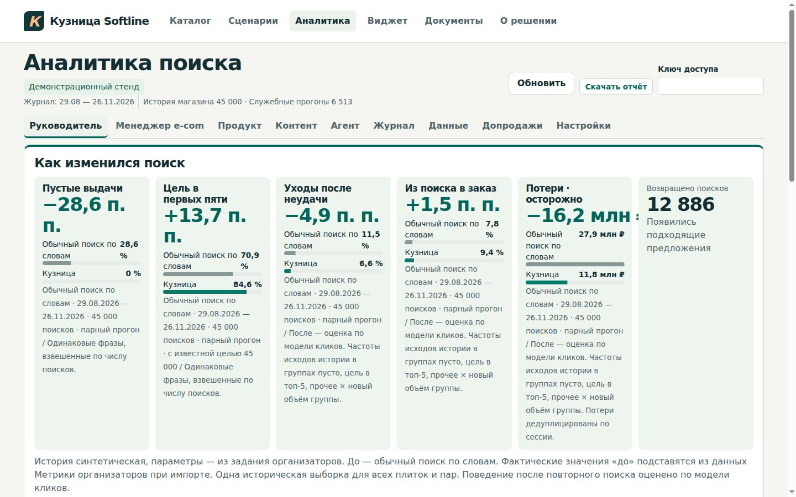
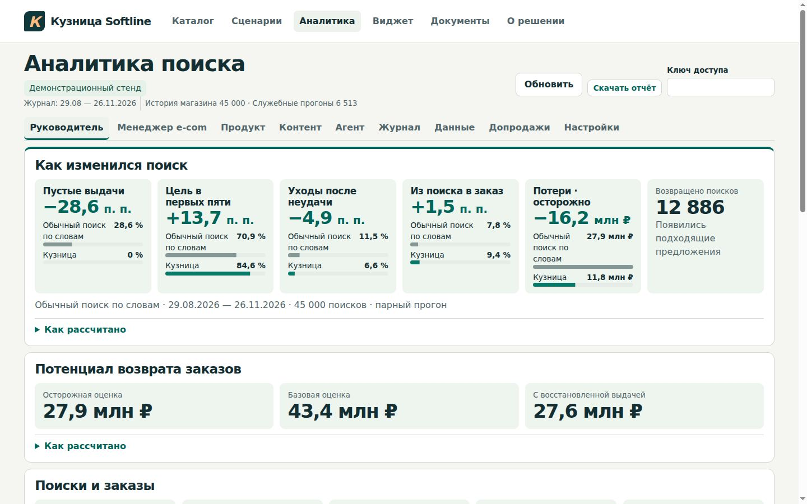
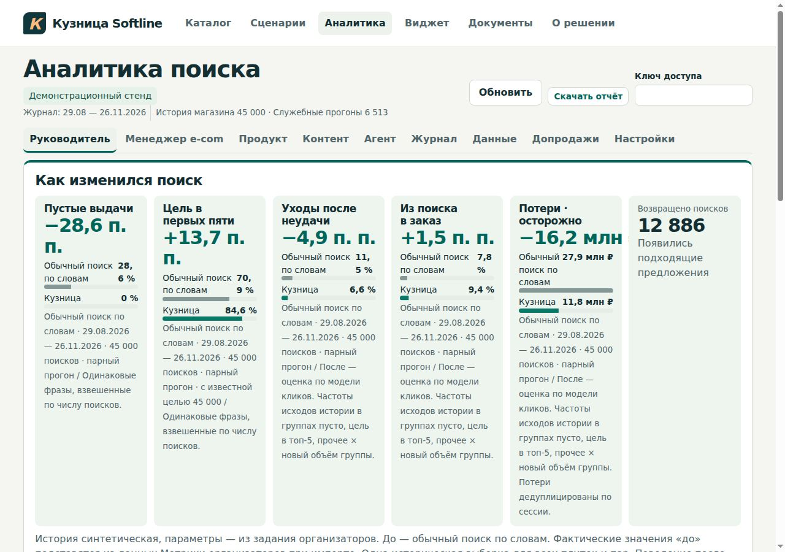
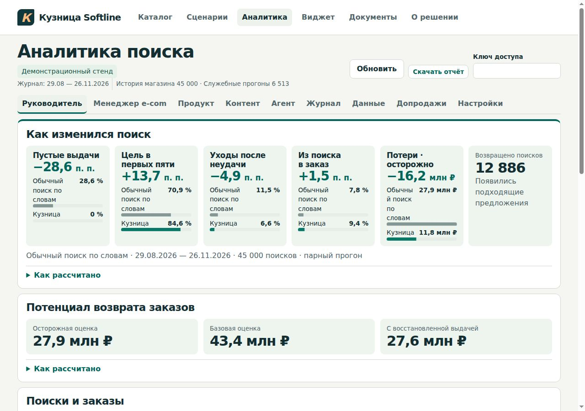
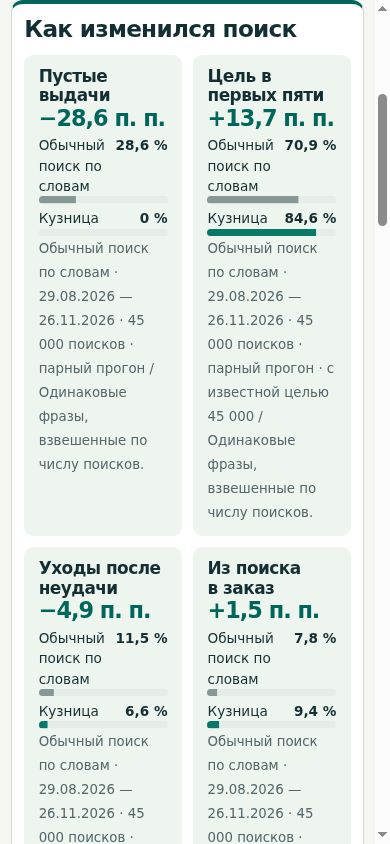
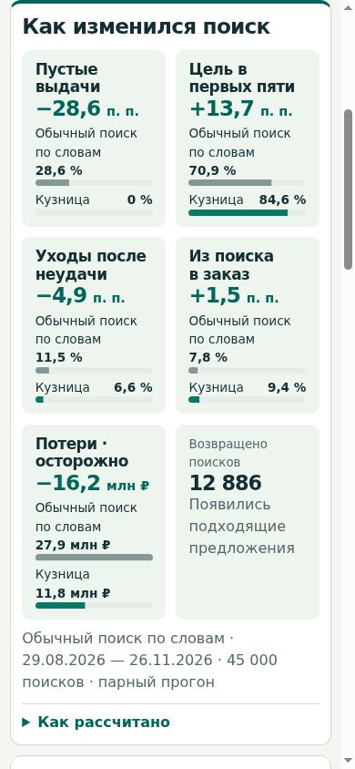
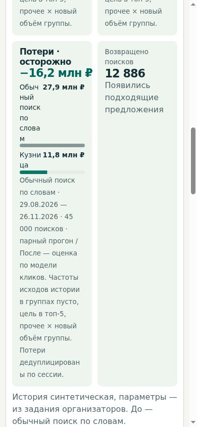
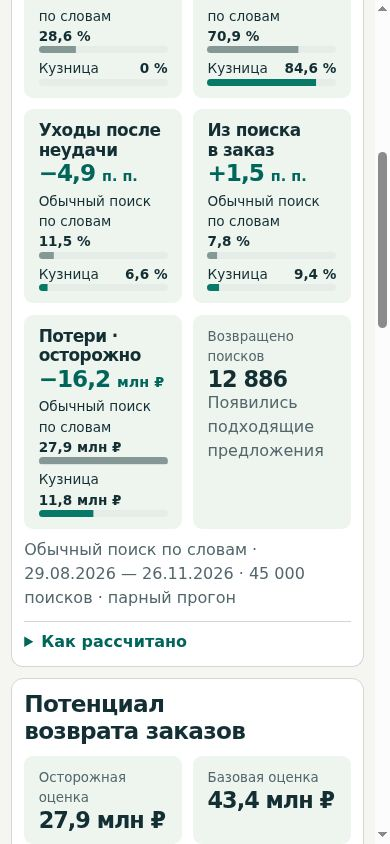
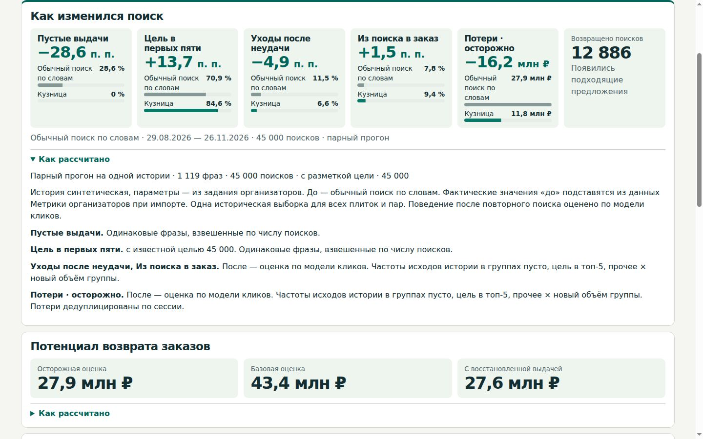

# C10 · Как изменился поиск

На вкладке «Руководитель» числовая дельта и её единица остаются на одной строке. Кегль зависит от внутренней ширины плитки, единица набрана мельче. Под рядом указан общий период и размер выборки. Кнопка «Как рассчитано» раскрывает основание парного прогона и пояснения к показателям, в том числе где результат оценён по модели кликов.

Для обеих версий взяты одни и те же ответы GET со стенда kuznitsa-test за 29.08–26.11.2026 (45 000 поисков). На исходной версии Chrome перенёс «п. п.» в первых двух плитках при 1440 и 1280 px. Значение «−16,2 млн ₽» вышло за внутреннюю ширину плитки на 43, 45 и 16 px соответственно при 1440, 1280 и 390 px. После исправления все пять дельт заняли по одной строке и поместились в свои плитки на всех трёх ширинах. Кадры настольной версии сделаны от верха страницы, на телефоне показан сам блок.

64 теста витрины прошли. Браузерный тест проверяет общую подпись под рядом и доступность пояснения при раскрытии.

| Размер окна | До | После |
|---|---|---|
| 1440 × 900 |  |  |
| 1280 × 900 |  |  |
| 390 × 844 |  |  |
| 390 × 844 · осторожная оценка потерь |  |  |

