# Как работает поиск «Кузница Softline»

## От запроса до ответа

Покупатель вводит название, задачу или условия закупки. Поиск распознаёт намерение, выбирает варианты лицензий и собирает ответ для этой задачи. У каждого поиска есть трасса.

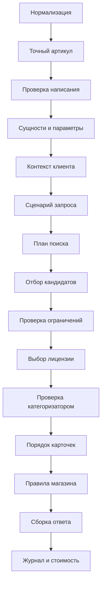

- **Нормализация.** Привести текст к единой записи и применить словарь магазина. [`normalize`](../kuznitsa/text.py#L10)
- **Точный артикул.** Проверить обозначения в словарях артикулов и региональных кодов. [`lookup_skus`](../kuznitsa/understand/normalize.py#L5)
- **Проверка написания.** Учесть раскладку, транслитерацию и опечатки. [`repair`](../kuznitsa/understand/repair.py#L42)
- **Сущности и параметры.** Выделить продукты, количество, условия закупки и исключения. [`extract`](../kuznitsa/understand/entities.py#L18)
- **Контекст клиента.** Учесть профиль организации, раздел и предыдущий запрос. [`Engine._search`](../kuznitsa/engine.py#L246)
- **Сценарий запроса.** Распознать цель покупателя по фразе и сущностям. [`route`](../kuznitsa/understand/routing.py#L9)
- **План поиска.** Выбрать способ отбора карточек. [`Engine._search`](../kuznitsa/engine.py#L246)
- **Отбор кандидатов.** Найти карточки по индексам каталога или связям базы знаний. [`candidates`](../kuznitsa/plans/base.py#L14)
- **Проверка ограничений.** Проверить условия и подготовить подсказки, если совпадений нет. [`Engine._search`](../kuznitsa/engine.py#L246)
- **Выбор лицензии.** Подобрать предложение с учётом метрики, срока и объёма. [`select`](../kuznitsa/rank/variants.py#L11)
- **Проверка категоризатором.** При выполнении условий умного режима уточнить близость предложений. [`Decisions.rerank`](../kuznitsa/llm/decisions.py#L128)
- **Порядок карточек.** Отсортировать по соответствию, популярности, марже и профилю. [`ranked`](../kuznitsa/rank/business.py#L6)
- **Правила магазина.** Применить подходящие правила продвижения. [`Controls.merch`](../kuznitsa/controls.py#L19)
- **Сборка ответа.** Собрать блоки для выбранного вида. [`compose`](../kuznitsa/plans/scenarios.py#L94)
- **Журнал и стоимость.** Записать результат и связать его с расходами по идентификатору поиска. [`Journal.search`](../kuznitsa/analytics/store.py#L175)

## Как читать трассу

Поле `understood.intent` показывает распознанную цель. В `trace` шаги идут в порядке выполнения. Статус `ok` означает, что шаг выполнен, `skip` — пропущен, `fallback` — выбран запасной путь. Причина и параметры находятся в `summary` и `detail`. Список `blocks` описывает результат для покупателя.

В примерах `guest` означает гостевой поиск. Именованный профиль добавляет условия организации и сведения о её лицензиях. Блоки перечислены в порядке показа: `products` — предложения, `kit` — комплект, `spec` — расчёт по позициям, `answer` — пояснение, `clarify` — уточнение, `lead` — обращение к менеджеру, `crosssell` — сопутствующие товары. Время открытия страницы зависит также от браузера и сети.

Замер 2026-11-21, версия ebfdfe4. Один вызов на строку в каждом режиме. В выборке 310 строк dev, 125 знакомых проб и 100 повторных запросов из примеров. Группировка по фактическому виду и запрошенному режиму. Время в миллисекундах, без запуска движка, HTTP и отрисовки браузером. p50 — медиана, p95 — граница для 95% наблюдений. Повторы могут попадать в кэш.

Шаг учитывает интервал с предыдущей отметки. Время выбора предложений внутри проверки условий движок вычитает из filters и переносит в variants. Стоимость записи журнала измеряется отдельно. Полное время взято из `timing_ms.total`. Перцентили разных шагов складывать нельзя. [`Trace.add`](../kuznitsa/engine.py#L56)

## Цена запроса

Быстрый режим стоит **0 ₽ за внешние модели**. Умный режим берёт расход из журнала `llm_calls` по `search_id`. Попадание в кэш имеет нулевую стоимость. Если шлюз не прислал сумму, движок оценивает расход по входным токенам. Пересчёт в рубли использует настройку `KZ_USD_RUB`. При тайм-ауте окончательная запись может появиться позже ответа. [`Decisions.request`](../kuznitsa/llm/decisions.py#L51)

За прогон журнал зарегистрировал 282 решений, в том числе 54 из кэша и 0 неуспешных. Ответ витрине может уйти по запасному пути до успешного завершения внешнего вызова. Расход по журналу — **$0.034353**.

<a id="sku"></a>

## Поиск по артикулу, SKU и номеру в реестре (`sku`)

Артикул из счёта или реестровый номер. Результат для покупателя — точная позиция или сообщение об отсутствии.

| Запрос | Профиль | Первая карточка | Блоки ответа |
|---|---|---|---|
| KL4867RAQFR | guest | Kaspersky Endpoint Security для бизнеса Расширенный | products, crosssell |
| FQC-10572 | guest | Microsoft Windows 11 Pro | products, crosssell |
| KL4867 | guest | Kaspersky Endpoint Security для бизнеса Расширенный | products, crosssell |
| артикул 4601546092816 | accounting_firm | 1С:Бухгалтерия 8 Базовая | products, crosssell |
| КL4867RАQFR | guest | Kaspersky Endpoint Security для бизнеса Расширенный | products, crosssell |

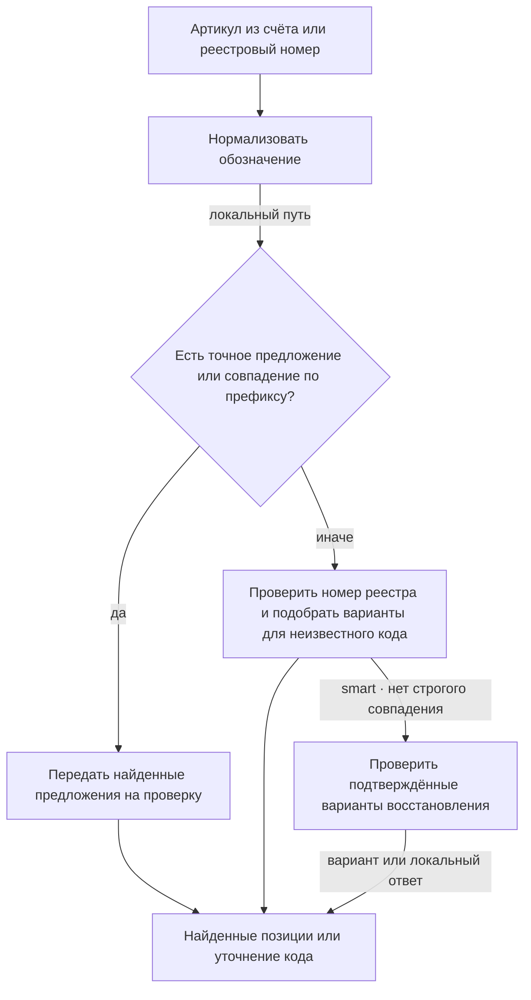

**Категоризатор.** Движок задаёт вопрос «Какой следующий шаг поиска подтверждён?» в умном режиме при пустой строгой выдаче без точного совпадения по артикулу.

Допустимые варианты — clarify, unavailable (если вариантов нет), audience (доступен обычный тариф). Минимальная вероятность выбора — 0,55. Если решение не принято, поиск продолжает локальный подбор.

**Время шагов, мс.** Быстрых запросов — 12, умных — 12, из них с возвратом к быстрому режиму — 0.

| Шаг | fast p50 | fast p95 | smart p50 | smart p95 |
|---|---:|---:|---:|---:|
| Нормализация | 0.08 | 0.14 | 0.10 | 0.16 |
| Точный артикул | 0.06 | 0.21 | 0.06 | 0.18 |
| Проверка написания | 0.02 | 0.07 | 0.03 | 0.08 |
| Сущности и параметры | 0.13 | 0.40 | 0.16 | 0.22 |
| Контекст клиента | 0.00 | 0.01 | 0.01 | 0.01 |
| Сценарий запроса | 0.02 | 0.30 | 0.02 | 0.04 |
| План поиска | 0.00 | 0.00 | 0.00 | 0.00 |
| Отбор кандидатов | 0.01 | 0.01 | 0.01 | 0.01 |
| Проверка ограничений | 0.02 | 0.02 | 0.02 | 81.74 |
| Выбор лицензии | 0.08 | 0.27 | 0.09 | 0.23 |
| Проверка категоризатором | 0.01 | 0.01 | 0.02 | 0.02 |
| Порядок карточек | 0.13 | 0.25 | 0.14 | 0.23 |
| Правила магазина | 0.01 | 0.01 | 0.01 | 0.02 |
| Сборка ответа | 3.14 | 9.79 | 3.14 | 5.63 |
| Журнал и стоимость | 0.63 | 2.25 | 0.66 | 1.61 |
| Весь запрос | 4.73 | 11.43 | 5.47 | 87.74 |

**За счёт чего быстро.** Поиск по ключу в skus и regional обходит полнотекстовый отбор. [`lookup_skus`](../kuznitsa/understand/normalize.py#L5)

**Что получает бизнес.** Закупщик проверяет конкретную строку счёта. По отсутствующим артикулам можно искать пробелы прайса.

<a id="product"></a>

## Конкретный продукт, редакция, версия и параметры лицензии (`product`)

Название семейства, редакция, срок и число мест. Результат для покупателя — карточки с выбранным вариантом лицензии.

| Запрос | Профиль | Первая карточка | Блоки ответа |
|---|---|---|---|
| 1с лицензии на 10 человек | guest | 1С:Предприятие 8 Клиентские лицензии КОРП | products, crosssell |
| Kaspersky Endpoint Security для бизнеса | guest | Kaspersky Endpoint Security для бизнеса Стандартный | products, crosssell |
| Astra Linux Special Edition | guest | Astra Linux Special Edition «Воронеж» | products, crosssell |
| 1С:Бухгалтерия 8 | guest | 1С:Бухгалтерия 8 Базовая | products, crosssell |
| МойОфис Стандартный 2 | guest | МойОфис Стандартный 2 Для бизнеса | products, crosssell |

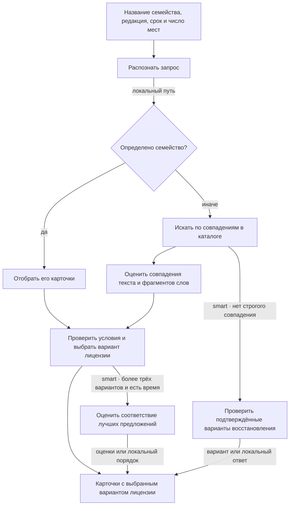

**Категоризатор.** Движок задаёт вопрос «Какой следующий шаг поиска подтверждён?» в умном режиме при пустой строгой выдаче без точного совпадения по артикулу.

Допустимые варианты — clarify, unavailable (если вариантов нет), qty (есть ближайшая ступень), audience (доступен обычный тариф). Минимальная вероятность выбора — 0,55. Если решение не принято, поиск продолжает локальный подбор.

**Время шагов, мс.** Быстрых запросов — 77, умных — 77, из них с возвратом к быстрому режиму — 0.

| Шаг | fast p50 | fast p95 | smart p50 | smart p95 |
|---|---:|---:|---:|---:|
| Нормализация | 0.09 | 0.14 | 0.11 | 0.19 |
| Точный артикул | 0.20 | 0.33 | 0.20 | 0.36 |
| Проверка написания | 0.11 | 13.06 | 0.14 | 0.31 |
| Сущности и параметры | 0.77 | 3.82 | 0.72 | 1.66 |
| Контекст клиента | 0.01 | 0.01 | 0.01 | 0.01 |
| Сценарий запроса | 0.04 | 0.07 | 0.04 | 0.08 |
| План поиска | 0.00 | 0.01 | 0.00 | 0.00 |
| Отбор кандидатов | 0.03 | 0.15 | 0.04 | 0.11 |
| Проверка ограничений | 0.03 | 0.08 | 0.03 | 49.76 |
| Выбор лицензии | 0.24 | 1.03 | 0.17 | 0.55 |
| Проверка категоризатором | 0.01 | 0.02 | 0.01 | 251.78 |
| Порядок карточек | 0.29 | 2.58 | 0.31 | 0.96 |
| Правила магазина | 0.01 | 0.02 | 0.01 | 0.02 |
| Сборка ответа | 5.00 | 10.10 | 3.21 | 6.19 |
| Журнал и стоимость | 0.83 | 4.28 | 0.86 | 1.42 |
| Весь запрос | 10.61 | 29.03 | 6.49 | 272.77 |

**За счёт чего быстро.** Индекс family сразу ограничивает выбор редакциями одного семейства. Для свободного текста готовы индекс BM25 и разреженная матрица фрагментов слов. При смысловом поиске вектор запроса сравнивается с заранее рассчитанными векторами карточек. [`candidates`](../kuznitsa/plans/base.py#L14) · [`Catalog.scores`](../kuznitsa/index/store.py#L133)

**Что получает бизнес.** Менеджер видит редакцию и объём, для которых покупатель запрашивает цену.

<a id="vendor"></a>

## Витрина и линейка вендора (`vendor`)

Название производителя или его линейки. Результат для покупателя — ассортимент производителя и фасеты.

| Запрос | Профиль | Первая карточка | Блоки ответа |
|---|---|---|---|
| все продукты Лаборатории Касперского | guest | Kaspersky ASAP Cloud | products |
| продукты СКБ Контур | guest | Контур.Экстерн Оптимальный плюс | products |
| Positive Technologies | ent_factory | Positive Technologies MaxPatrol SIEM | my_licenses, products |
| rfcgthcrbq | guest | Kaspersky Endpoint Security для бизнеса Стандартный | products |
| уыукпфеу | guest | UserGate NGFW ПАК | products |

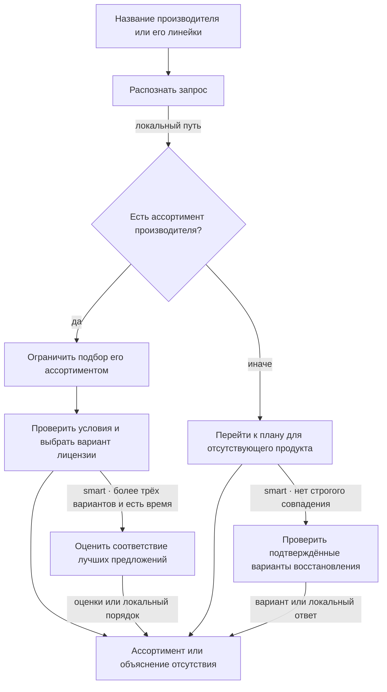

**Категоризатор.** Движок задаёт вопрос «Какой следующий шаг поиска подтверждён?» в умном режиме при пустой строгой выдаче без точного совпадения по артикулу.

Допустимые варианты — clarify, unavailable (если вариантов нет), qty (есть ближайшая ступень), audience (доступен обычный тариф). Минимальная вероятность выбора — 0,55. Если решение не принято, поиск продолжает локальный подбор.

**Время шагов, мс.** Быстрых запросов — 15, умных — 15, из них с возвратом к быстрому режиму — 0.

| Шаг | fast p50 | fast p95 | smart p50 | smart p95 |
|---|---:|---:|---:|---:|
| Нормализация | 0.08 | 0.12 | 0.09 | 0.13 |
| Точный артикул | 0.14 | 0.26 | 0.15 | 0.23 |
| Проверка написания | 0.10 | 12.52 | 0.11 | 0.17 |
| Сущности и параметры | 0.35 | 0.70 | 0.34 | 0.55 |
| Контекст клиента | 0.01 | 0.01 | 0.01 | 0.02 |
| Сценарий запроса | 0.04 | 1.02 | 0.04 | 1.28 |
| План поиска | 0.00 | 0.01 | 0.00 | 0.00 |
| Отбор кандидатов | 2.63 | 7.17 | 0.06 | 0.10 |
| Проверка ограничений | 0.04 | 0.08 | 0.04 | 0.06 |
| Выбор лицензии | 0.62 | 4.22 | 0.52 | 1.17 |
| Проверка категоризатором | 0.02 | 0.02 | 0.05 | 360.96 |
| Порядок карточек | 1.51 | 5.03 | 1.64 | 2.82 |
| Правила магазина | 0.02 | 0.10 | 0.02 | 0.05 |
| Сборка ответа | 0.04 | 0.05 | 0.05 | 0.09 |
| Журнал и стоимость | 1.09 | 4.56 | 1.17 | 1.81 |
| Весь запрос | 11.14 | 23.96 | 11.11 | 368.01 |

**За счёт чего быстро.** Индекс vendor хранит готовые множества карточек. [`candidates`](../kuznitsa/plans/base.py#L14)

**Что получает бизнес.** Отдел закупок может оценить спрос на ассортимент производителя.

<a id="category"></a>

## Подбор по классу ПО с фильтрами и исключениями (`category`)

Класс программ, ограничения и исключения. Результат для покупателя — подходящие лицензии и фильтры каталога.

| Запрос | Профиль | Первая карточка | Блоки ответа |
|---|---|---|---|
| антивирус на 30 пк | guest | Kaspersky Endpoint Security для бизнеса Стандартный | products |
| офисный пакет | guest | Microsoft Office Home and Business | products |
| удаленный доступ | guest | Ассистент Стандартный | products |
| резервное копирование | guest | Кибер Бэкап Стандартный | products |
| видеоконференцсвязь | guest | IVA MCU | products |

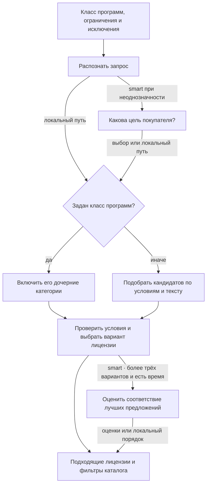

**Категоризатор.** Движок задаёт вопрос «Какова цель покупателя?» в smart при признаках неоднозначности и наличии опоры в запросе.

Допустимые варианты — category, broad, task, product, off_topic. Минимальная вероятность выбора — 0,55. При недостаточной уверенности или противоречии подтверждённым условиям сохраняется локальная цель. Для изменения ряда условий требуется 0,85.

**Время шагов, мс.** Быстрых запросов — 92, умных — 92, из них с возвратом к быстрому режиму — 7.

| Шаг | fast p50 | fast p95 | smart p50 | smart p95 |
|---|---:|---:|---:|---:|
| Нормализация | 0.09 | 0.14 | 0.12 | 0.20 |
| Точный артикул | 0.16 | 0.29 | 0.20 | 0.31 |
| Проверка написания | 0.09 | 3.31 | 0.11 | 0.18 |
| Сущности и параметры | 0.48 | 3.96 | 0.51 | 1.11 |
| Контекст клиента | 0.01 | 0.01 | 0.01 | 0.01 |
| Сценарий запроса | 0.05 | 0.11 | 0.13 | 294.86 |
| План поиска | 0.00 | 0.01 | 0.00 | 0.02 |
| Отбор кандидатов | 2.20 | 8.96 | 0.12 | 0.28 |
| Проверка ограничений | 0.07 | 0.21 | 0.08 | 97.71 |
| Выбор лицензии | 0.86 | 4.04 | 0.72 | 4.49 |
| Проверка категоризатором | 0.02 | 0.02 | 257.86 | 335.35 |
| Порядок карточек | 1.28 | 4.85 | 1.56 | 4.09 |
| Правила магазина | 0.02 | 0.02 | 0.02 | 0.03 |
| Сборка ответа | 0.05 | 0.09 | 0.06 | 0.09 |
| Журнал и стоимость | 0.94 | 2.93 | 1.33 | 6.53 |
| Весь запрос | 7.11 | 20.25 | 296.24 | 606.00 |

**За счёт чего быстро.** Множества карточек категорий пересекаются до выбора лицензии. При уверенно определённом классе отбор по тексту обходится без расчёта смыслового вектора. [`candidates`](../kuznitsa/plans/base.py#L14)

**Что получает бизнес.** Менеджер видит, какие сочетания требований оставляют покупателю мало вариантов.

<a id="task"></a>

## Поиск от проблемы и бизнес-задачи (`task`)

Потребность на языке покупателя. Результат для покупателя — программы с пояснением по задаче.

| Запрос | Профиль | Первая карточка | Блоки ответа |
|---|---|---|---|
| чем открыть dwg | guest | Платформа nanoCAD Базовая | products |
| чтобы сотрудники не сливали базу клиентов | smb_trade | InfoWatch Traffic Monitor | products |
| запретить копирование на флешки | guest | Dallas Lock 8.0-C | products |
| подписывать кадровые документы с удаленщиками | it_company | СБИС Saby ЭДО | products |
| распознать сканы паспортов и накладных в текст | guest | ContentCapture Standard | products |

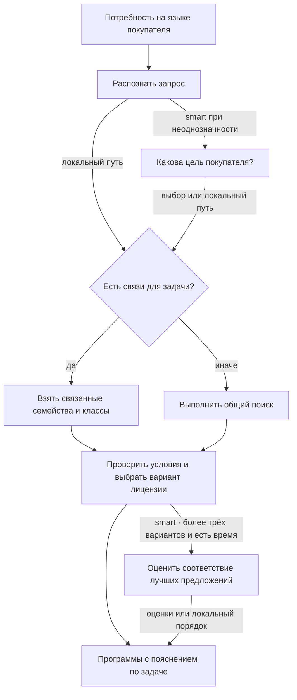

**Категоризатор.** Движок задаёт вопрос «Какова цель покупателя?» в smart при признаках неоднозначности и наличии опоры в запросе.

Допустимые варианты — task, broad, category, product, off_topic. Минимальная вероятность выбора — 0,55. При недостаточной уверенности или противоречии подтверждённым условиям сохраняется локальная цель. Для изменения ряда условий требуется 0,85.

**Время шагов, мс.** Быстрых запросов — 23, умных — 23, из них с возвратом к быстрому режиму — 2.

| Шаг | fast p50 | fast p95 | smart p50 | smart p95 |
|---|---:|---:|---:|---:|
| Нормализация | 0.11 | 0.16 | 0.14 | 0.22 |
| Точный артикул | 0.25 | 0.39 | 0.31 | 0.45 |
| Проверка написания | 0.14 | 6.22 | 0.20 | 0.32 |
| Сущности и параметры | 0.85 | 4.44 | 0.50 | 1.05 |
| Контекст клиента | 0.01 | 0.01 | 0.01 | 0.01 |
| Сценарий запроса | 0.06 | 0.31 | 249.89 | 309.69 |
| План поиска | 0.00 | 0.01 | 0.01 | 0.02 |
| Отбор кандидатов | 0.04 | 0.06 | 0.06 | 0.07 |
| Проверка ограничений | 0.04 | 0.08 | 0.04 | 0.08 |
| Выбор лицензии | 0.75 | 3.80 | 0.54 | 1.16 |
| Проверка категоризатором | 0.02 | 0.02 | 247.84 | 320.80 |
| Порядок карточек | 1.16 | 9.39 | 1.54 | 4.82 |
| Правила магазина | 0.01 | 0.03 | 0.02 | 0.04 |
| Сборка ответа | 0.04 | 0.07 | 0.05 | 0.10 |
| Журнал и стоимость | 0.99 | 4.16 | 1.24 | 2.58 |
| Весь запрос | 7.87 | 19.03 | 526.62 | 603.76 |

**За счёт чего быстро.** Запись use_cases связывает потребность с готовыми группами товаров. [`scope`](../kuznitsa/plans/scenarios.py#L39)

**Что получает бизнес.** Формулировки клиентов дают материал для словаря задач и категорий магазина.

<a id="role_kit"></a>

## Комплект ПО по профессии, АРМ или ситуации (`role_kit`)

Профессия, рабочее место и число сотрудников. Результат для покупателя — комплект по роли или уточнение.

| Запрос | Профиль | Первая карточка | Блоки ответа |
|---|---|---|---|
| комплект по для бухгалтера | guest | 1С:Бухгалтерия 8 Базовая | kit, crosssell |
| рабочее место госслужащего из реестра | gov_clinic | Astra Linux Special Edition «Смоленск» | kit, crosssell |
| набор программ для конструктора | ent_factory | АСКОН КОМПАС Строитель | kit, crosssell |
| базовый набор по для офиса на 20 человек | guest | Astra Linux Special Edition «Воронеж» | kit, crosssell |
| сколько стоит перевести офис на 50 пк на российское по | guest | Р7-Офис Профессиональный | kit, crosssell |

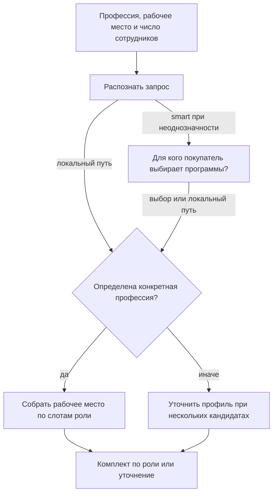

**Категоризатор.** Движок задаёт вопрос «Для кого покупатель выбирает программы?» в smart для неточного названия роли или отрасли с подходящими кандидатами.

Допустимые варианты — до восьми ID ролей и отраслей из локального списка, none. Минимальная вероятность выбора — 0,55. Локальная оценка совпадения или уточнение профиля.

**Время шагов, мс.** Быстрых запросов — 97, умных — 97, из них с возвратом к быстрому режиму — 0.

| Шаг | fast p50 | fast p95 | smart p50 | smart p95 |
|---|---:|---:|---:|---:|
| Нормализация | 0.11 | 0.21 | 0.11 | 0.19 |
| Точный артикул | 0.18 | 0.40 | 0.20 | 0.37 |
| Проверка написания | 0.14 | 7.62 | 0.14 | 0.36 |
| Сущности и параметры | 0.38 | 24.69 | 0.34 | 190.00 |
| Контекст клиента | 0.01 | 0.01 | 0.01 | 0.02 |
| Сценарий запроса | 0.04 | 0.07 | 0.04 | 0.08 |
| План поиска | 0.00 | 0.01 | 0.00 | 0.01 |
| Отбор кандидатов | 0.07 | 0.12 | 0.06 | 0.12 |
| Проверка ограничений | 0.11 | 0.19 | 0.10 | 0.20 |
| Выбор лицензии | 1.49 | 7.43 | 1.29 | 3.91 |
| Проверка категоризатором | 0.02 | 0.05 | 0.06 | 0.12 |
| Порядок карточек | 5.00 | 12.04 | 3.45 | 6.04 |
| Правила магазина | 0.03 | 0.06 | 0.03 | 0.08 |
| Сборка ответа | 2.66 | 10.86 | 2.44 | 5.20 |
| Журнал и стоимость | 1.64 | 7.63 | 1.49 | 2.62 |
| Весь запрос | 16.87 | 45.98 | 9.88 | 202.15 |

**За счёт чего быстро.** Слоты роли ссылаются на семейства в индексе каталога. Точные названия и веса слов подготовлены в KitIndex до запроса. [`KitIndex.candidates`](../kuznitsa/understand/kits.py#L71)

**Что получает бизнес.** Менеджер получает перечень программ для оснащения рабочего места.

<a id="industry"></a>

## Подбор программ для отрасли и по коду ОКВЭД (`industry`)

Вид организации или код ОКВЭД. Результат для покупателя — отраслевой комплект или уточнение.

| Запрос | Профиль | Первая карточка | Блоки ответа |
|---|---|---|---|
| по для строительной компании | guest | ГРАНД-Смета Локальная | kit |
| по для стоматологии | guest | Инфоклиника On-Premise | kit |
| софт в аптеку | guest | АТОЛ Frontol 6 Start | kit |
| по для лаборатории | guest | Инфоклиника On-Premise | kit |
| по для ветеринарной клиники | guest | Битрикс24 Облако Базовый | kit |

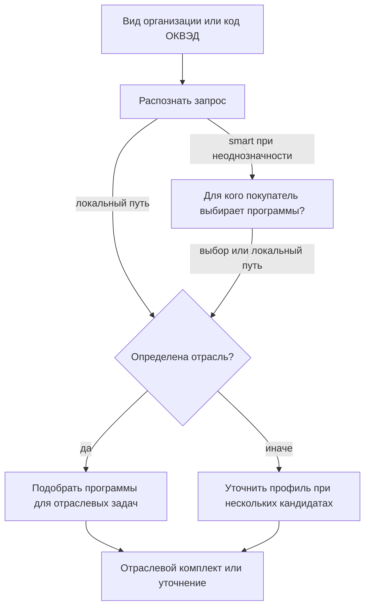

**Категоризатор.** Движок задаёт вопрос «Для кого покупатель выбирает программы?» в smart для неточного названия роли или отрасли с подходящими кандидатами.

Допустимые варианты — до восьми ID ролей и отраслей из локального списка, none. Минимальная вероятность выбора — 0,55. Локальная оценка совпадения или уточнение профиля.

**Время шагов, мс.** Быстрых запросов — 46, умных — 46, из них с возвратом к быстрому режиму — 0.

| Шаг | fast p50 | fast p95 | smart p50 | smart p95 |
|---|---:|---:|---:|---:|
| Нормализация | 0.10 | 0.16 | 0.09 | 0.14 |
| Точный артикул | 0.18 | 0.51 | 0.16 | 0.22 |
| Проверка написания | 0.14 | 9.81 | 0.10 | 0.22 |
| Сущности и параметры | 0.38 | 27.94 | 0.29 | 0.76 |
| Контекст клиента | 0.01 | 0.02 | 0.00 | 0.01 |
| Сценарий запроса | 0.04 | 0.09 | 0.03 | 0.08 |
| План поиска | 0.00 | 0.01 | 0.00 | 0.01 |
| Отбор кандидатов | 0.07 | 0.14 | 0.06 | 0.12 |
| Проверка ограничений | 0.12 | 1.81 | 0.10 | 0.20 |
| Выбор лицензии | 1.76 | 7.86 | 1.40 | 2.08 |
| Проверка категоризатором | 0.02 | 0.03 | 0.06 | 0.10 |
| Порядок карточек | 5.53 | 12.50 | 3.92 | 5.73 |
| Правила магазина | 0.03 | 0.08 | 0.02 | 0.04 |
| Сборка ответа | 0.20 | 0.64 | 0.18 | 0.48 |
| Журнал и стоимость | 1.53 | 4.62 | 1.27 | 1.96 |
| Весь запрос | 14.39 | 49.08 | 7.73 | 13.08 |

**За счёт чего быстро.** Состав отраслевого комплекта хранится в базе знаний. Точные названия и веса слов подготовлены в KitIndex до запроса. [`KitIndex.candidates`](../kuznitsa/understand/kits.py#L71)

**Что получает бизнес.** Закупщик получает отправную точку для сметы по своей отрасли.

<a id="analog"></a>

## Импортозамещение, замена продукта и миграция стека (`analog`)

Исходный продукт и условия замены. Результат для покупателя — варианты замены с пояснениями.

| Запрос | Профиль | Первая карточка | Блоки ответа |
|---|---|---|---|
| российский аналог microsoft office | guest | МойОфис Профессиональный Корпоративная | analogs |
| замена autocad из реестра | design_bureau | Платформа nanoCAD Базовая | analogs |
| аналог vmware vsphere российский | ent_factory | zVirt Standard | analogs |
| чем заменить zoom для компании | guest | SaluteJazz On-Premise | analogs |
| российский аналог jira и confluence | it_company | Yonote | analogs |

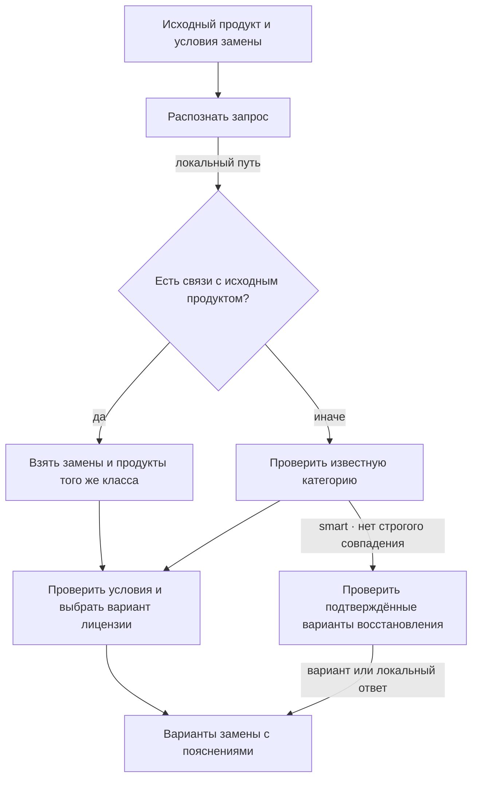

**Категоризатор.** Движок задаёт вопрос «Какой следующий шаг поиска подтверждён?» в умном режиме при пустой строгой выдаче без точного совпадения по артикулу.

Допустимые варианты — clarify, unavailable (если вариантов нет), audience (доступен обычный тариф). Минимальная вероятность выбора — 0,55. Если решение не принято, поиск продолжает локальный подбор.

**Время шагов, мс.** Быстрых запросов — 20, умных — 20, из них с возвратом к быстрому режиму — 0.

| Шаг | fast p50 | fast p95 | smart p50 | smart p95 |
|---|---:|---:|---:|---:|
| Нормализация | 0.10 | 0.13 | 0.12 | 0.26 |
| Точный артикул | 0.20 | 0.69 | 0.24 | 0.31 |
| Проверка написания | 0.13 | 0.21 | 0.16 | 0.19 |
| Сущности и параметры | 0.92 | 4.01 | 0.60 | 1.06 |
| Контекст клиента | 0.01 | 0.01 | 0.01 | 0.01 |
| Сценарий запроса | 0.04 | 0.09 | 0.03 | 0.05 |
| План поиска | 0.00 | 0.00 | 0.00 | 0.00 |
| Отбор кандидатов | 0.19 | 0.85 | 0.19 | 0.54 |
| Проверка ограничений | 0.04 | 0.08 | 0.04 | 15.20 |
| Выбор лицензии | 0.96 | 7.18 | 0.57 | 1.23 |
| Проверка категоризатором | 0.02 | 0.02 | 0.02 | 0.04 |
| Порядок карточек | 1.41 | 7.10 | 1.31 | 2.22 |
| Правила магазина | 0.02 | 0.03 | 0.02 | 0.02 |
| Сборка ответа | 0.07 | 0.31 | 0.06 | 0.10 |
| Журнал и стоимость | 1.02 | 4.62 | 1.20 | 2.44 |
| Весь запрос | 10.32 | 20.77 | 5.11 | 22.86 |

**За счёт чего быстро.** Справочник замен и индекс family дают кандидатов по идентификатору. [`scope`](../kuznitsa/plans/scenarios.py#L39)

**Что получает бизнес.** Менеджер может начать обсуждение миграции с доступных в каталоге альтернатив.

<a id="compliance"></a>

## Комплаенс, реестр, сертификация и тендерное ТЗ (`compliance`)

Условия закупки, сертификат или код. Результат для покупателя — пояснение требований и результаты проверки.

| Запрос | Профиль | Первая карточка | Блоки ответа |
|---|---|---|---|
| окпд2 58.29.11 | gov_clinic | Astra Linux Special Edition «Смоленск» | answer, products |
| ктру 58.29.29.000 | gov_clinic | ГИС Панорама Мини | answer, products |
| офис без ндс из реестра | guest | МойОфис Стандартный Для бизнеса | answer, products |
| антивирус без ндс для юрлиц | smb_trade | Kaspersky Endpoint Security для бизнеса Стандартный | answer, products |
| антивирус из реестра минцифры | guest | Kaspersky Endpoint Security для бизнеса Стандартный | answer, products |

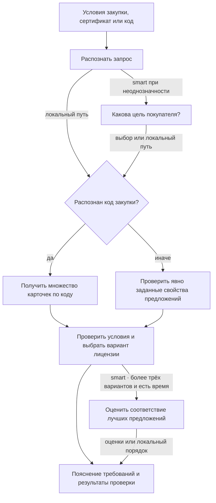

**Категоризатор.** Движок задаёт вопрос «Какова цель покупателя?» в smart при признаках неоднозначности и наличии опоры в запросе.

Допустимые варианты — compliance, broad, task, category, product, off_topic. Минимальная вероятность выбора — 0,55. При недостаточной уверенности или противоречии подтверждённым условиям сохраняется локальная цель. Для изменения ряда условий требуется 0,85.

**Время шагов, мс.** Быстрых запросов — 27, умных — 27, из них с возвратом к быстрому режиму — 0.

| Шаг | fast p50 | fast p95 | smart p50 | smart p95 |
|---|---:|---:|---:|---:|
| Нормализация | 0.11 | 0.14 | 0.13 | 0.20 |
| Точный артикул | 0.21 | 0.45 | 0.23 | 0.44 |
| Проверка написания | 0.12 | 5.86 | 0.15 | 0.31 |
| Сущности и параметры | 0.51 | 3.86 | 0.54 | 0.84 |
| Контекст клиента | 0.01 | 0.01 | 0.01 | 0.01 |
| Сценарий запроса | 0.05 | 0.59 | 0.05 | 0.80 |
| План поиска | 0.00 | 0.01 | 0.00 | 0.01 |
| Отбор кандидатов | 2.21 | 8.90 | 0.12 | 1.08 |
| Проверка ограничений | 0.05 | 2.29 | 0.05 | 0.48 |
| Выбор лицензии | 0.78 | 15.58 | 0.66 | 10.50 |
| Проверка категоризатором | 0.02 | 0.05 | 237.62 | 322.50 |
| Порядок карточек | 1.33 | 19.80 | 1.61 | 16.65 |
| Правила магазина | 0.02 | 0.07 | 0.02 | 0.10 |
| Сборка ответа | 0.05 | 0.08 | 0.06 | 0.10 |
| Журнал и стоимость | 0.99 | 3.81 | 1.23 | 2.27 |
| Весь запрос | 7.11 | 45.65 | 250.59 | 506.07 |

**За счёт чего быстро.** Движок хранит индекс procurement для кодов закупки. [`Engine._search`](../kuznitsa/engine.py#L246)

**Что получает бизнес.** Закупщик видит, какие заявленные условия подтверждаются данными о предложении.

<a id="renewal"></a>

## Продление лицензий и подписок (`renewal`)

Наименование подписки и условия продления. Результат для покупателя — предложения продления с параметрами лицензии.

| Запрос | Профиль | Первая карточка | Блоки ответа |
|---|---|---|---|
| каспер продление на 30 компов | smb_trade | Kaspersky Endpoint Security для бизнеса Стандартный | products, crosssell |
| продлёнка др веб 100 пк | guest | Dr.Web Enterprise Security Suite Защита рабочих станций | products, crosssell |
| продлить р7 офис на 25 пользователей | guest | Р7-Офис Профессиональный | products, crosssell |
| пролонгация кибер бэкап 5 серверов | retail_logistics | Кибер Бэкап Расширенный | products, crosssell |
| продлить 1с итс проф на год | smb_trade | 1С:ИТС ПРОФ | products, crosssell |

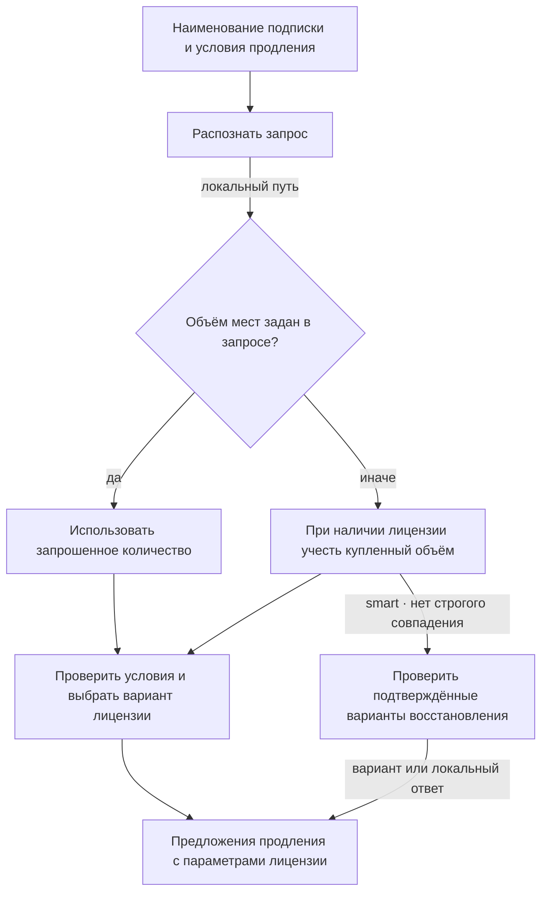

**Категоризатор.** Движок задаёт вопрос «Какой следующий шаг поиска подтверждён?» в умном режиме при пустой строгой выдаче без точного совпадения по артикулу.

Допустимые варианты — clarify, unavailable (если вариантов нет), audience (доступен обычный тариф). Минимальная вероятность выбора — 0,55. Если решение не принято, поиск продолжает локальный подбор.

**Время шагов, мс.** Быстрых запросов — 14, умных — 14, из них с возвратом к быстрому режиму — 0.

| Шаг | fast p50 | fast p95 | smart p50 | smart p95 |
|---|---:|---:|---:|---:|
| Нормализация | 0.11 | 9.85 | 0.12 | 0.16 |
| Точный артикул | 0.30 | 2.89 | 0.29 | 0.38 |
| Проверка написания | 0.16 | 8.52 | 0.19 | 0.55 |
| Сущности и параметры | 0.70 | 2.47 | 0.60 | 0.96 |
| Контекст клиента | 0.01 | 0.01 | 0.01 | 0.01 |
| Сценарий запроса | 0.04 | 0.05 | 0.04 | 0.04 |
| План поиска | 0.00 | 0.00 | 0.00 | 0.02 |
| Отбор кандидатов | 0.04 | 29.06 | 0.04 | 0.11 |
| Проверка ограничений | 0.06 | 0.09 | 0.05 | 0.06 |
| Выбор лицензии | 0.29 | 1.11 | 0.16 | 0.42 |
| Проверка категоризатором | 0.01 | 0.02 | 0.01 | 0.02 |
| Порядок карточек | 0.30 | 0.59 | 0.30 | 0.55 |
| Правила магазина | 0.01 | 0.02 | 0.01 | 0.07 |
| Сборка ответа | 3.22 | 20.41 | 3.31 | 4.67 |
| Журнал и стоимость | 0.84 | 1.94 | 0.88 | 1.24 |
| Весь запрос | 20.90 | 42.72 | 6.24 | 7.71 |

**За счёт чего быстро.** Варианты лицензии сгруппированы внутри карточки. [`select`](../kuznitsa/rank/variants.py#L11)

**Что получает бизнес.** Отдел продаж может подготовить предложение на следующий период обслуживания.

<a id="license_ops"></a>

## Докупка, апгрейд, кроссгрейд и клиентские лицензии (`license_ops`)

Докупка, переход на другую редакцию или вопрос о правах. Результат для покупателя — предложения для операции или ответ из FAQ.

| Запрос | Профиль | Первая карточка | Блоки ответа |
|---|---|---|---|
| долицензирование kes на 15 пк | ent_factory | Kaspersky Endpoint Security для бизнеса Расширенный | products |
| докупить 5 мест мой офис | guest | МойОфис Стандартный Для бизнеса | products |
| апгрейд 1с бухгалтерия базовая на проф | guest | 1С:Бухгалтерия 8 Базовая | products |
| переход с eset на касперский со скидкой 50 пк | guest | Kaspersky Symphony Security | products |
| миграция с microsoft office на р7 со скидкой | guest | Р7-Офис Профессиональный | products |

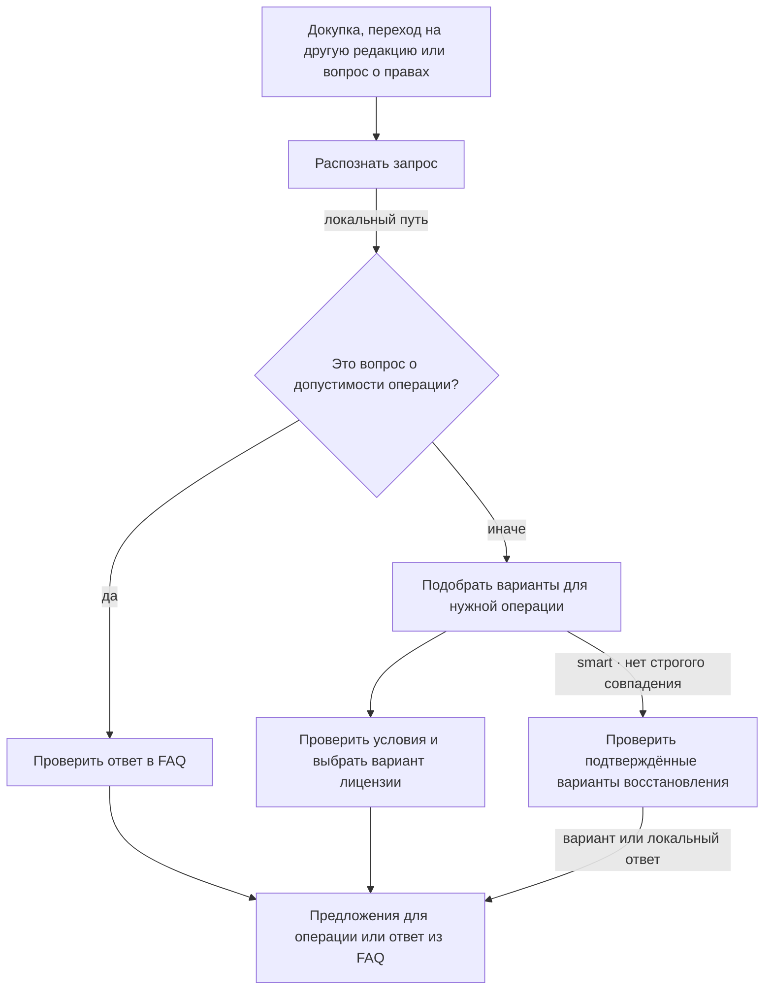

**Категоризатор.** Движок задаёт вопрос «Какой следующий шаг поиска подтверждён?» в умном режиме при пустой строгой выдаче без точного совпадения по артикулу.

Допустимые варианты — clarify, unavailable (если вариантов нет), audience (доступен обычный тариф). Минимальная вероятность выбора — 0,55. Если решение не принято, поиск продолжает локальный подбор.

**Время шагов, мс.** Быстрых запросов — 11, умных — 11, из них с возвратом к быстрому режиму — 0.

| Шаг | fast p50 | fast p95 | smart p50 | smart p95 |
|---|---:|---:|---:|---:|
| Нормализация | 0.10 | 0.13 | 0.10 | 0.18 |
| Точный артикул | 0.26 | 0.34 | 0.25 | 0.36 |
| Проверка написания | 0.16 | 2.70 | 0.19 | 0.26 |
| Сущности и параметры | 0.69 | 10.28 | 0.64 | 1.17 |
| Контекст клиента | 0.01 | 0.01 | 0.01 | 0.01 |
| Сценарий запроса | 0.03 | 0.04 | 0.03 | 0.05 |
| План поиска | 0.00 | 0.00 | 0.00 | 0.00 |
| Отбор кандидатов | 0.03 | 26.04 | 0.04 | 0.08 |
| Проверка ограничений | 0.04 | 0.11 | 0.06 | 288.36 |
| Выбор лицензии | 0.34 | 2.92 | 0.31 | 1.34 |
| Проверка категоризатором | 0.01 | 0.02 | 0.01 | 0.04 |
| Порядок карточек | 0.38 | 0.97 | 0.41 | 1.50 |
| Правила магазина | 0.01 | 0.02 | 0.01 | 0.02 |
| Сборка ответа | 0.04 | 0.11 | 0.04 | 0.06 |
| Журнал и стоимость | 0.56 | 0.79 | 0.71 | 2.60 |
| Весь запрос | 3.17 | 42.64 | 2.78 | 293.15 |

**За счёт чего быстро.** Сравнение условий выполняется по полям лицензии предложения. [`select`](../kuznitsa/rank/variants.py#L11)

**Что получает бизнес.** Менеджер может отделить запрос на расширение установленного ПО от покупки новой лицензии.

<a id="spec_list"></a>

## Многострочные спецификации, файлы и сметы из переписки (`spec_list`)

Перечень позиций и количества. Результат для покупателя — таблица расчёта и список нерешённых строк.

| Запрос | Профиль | Первая карточка | Блоки ответа |
|---|---|---|---|
| астра линукс 20 шт<br>р7 офис 20 шт<br>касперский 20 узлов | guest | Astra Linux Special Edition «Воронеж» | spec |
| 1. криптопро 5.0 - 5 шт<br>2. рутокен эцп 3.0 - 5 шт<br>3. контур диадок - 1 шт<br>4. 1с бухгалтерия проф - 1 шт | smb_trade | КриптоПро CSP Серверная | spec |
| Добрый день! Выставьте счет:<br>- Astra Linux SE Воронеж 25 шт<br>- Р7-Офис Проф 25 лицензий<br>- Kaspersky Endpoint Security продление 25 узлов | gov_clinic | Astra Linux Special Edition «Воронеж» | spec |
| КL4867RАQFR 30 шт<br>МойОфис Стандартный 30 мест<br>Кибер Бэкап 2 сервера | guest | Kaspersky Endpoint Security для бизнеса Расширенный | spec |
| 1. nanoCAD 24 сетевая - 4 шт<br>2. Renga Professional - 2 шт<br>3. Гранд-Смета - 1 шт<br>4. Р7-Офис - 10 шт<br>5. Кибер Бэкап - 1 сервер | design_bureau | Платформа nanoCAD Pro | spec |

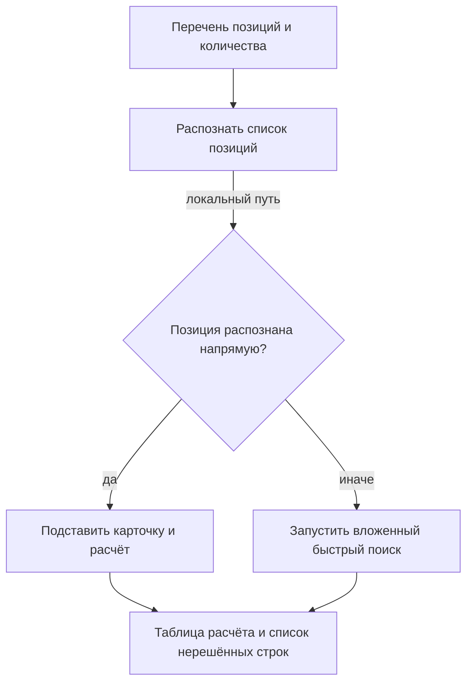

**Время шагов, мс.** Быстрых запросов — 11, умных — 11, из них с возвратом к быстрому режиму — 0.

| Шаг | fast p50 | fast p95 | smart p50 | smart p95 |
|---|---:|---:|---:|---:|
| Нормализация | 0.15 | 0.25 | 0.17 | 0.27 |
| Точный артикул | 0.02 | 1.56 | 0.02 | 0.22 |
| Проверка написания | 0.03 | 0.14 | 0.03 | 0.13 |
| Сущности и параметры | 0.07 | 0.54 | 0.08 | 0.48 |
| Контекст клиента | 0.00 | 0.01 | 0.01 | 0.01 |
| Сценарий запроса | 0.03 | 0.04 | 0.03 | 0.04 |
| План поиска | 0.00 | 0.00 | 0.00 | 0.00 |
| Отбор кандидатов | 0.01 | 0.01 | 0.01 | 0.02 |
| Проверка ограничений | 0.01 | 0.02 | 0.01 | 0.02 |
| Выбор лицензии | 0.00 | 0.00 | 0.00 | 0.00 |
| Проверка категоризатором | 0.01 | 0.01 | 0.01 | 0.02 |
| Порядок карточек | 0.02 | 0.03 | 0.02 | 0.04 |
| Правила магазина | 0.01 | 0.01 | 0.01 | 0.01 |
| Сборка ответа | 4.97 | 32.33 | 5.23 | 9.67 |
| Журнал и стоимость | 0.81 | 1.27 | 0.82 | 1.23 |
| Весь запрос | 6.36 | 34.31 | 6.85 | 11.58 |

**За счёт чего быстро.** Повторяющиеся строки одной спецификации используют кэш run_line. [`Engine._search`](../kuznitsa/engine.py#L246)

**Что получает бизнес.** Закупщик получает основу сметы и видит строки, требующие помощи менеджера.

<a id="compare"></a>

## Сравнение продуктов по фактам базы знаний (`compare`)

Названия продуктов или редакций. Результат для покупателя — таблица сравнения по полям каталога.

| Запрос | Профиль | Первая карточка | Блоки ответа |
|---|---|---|---|
| чем отличается астра орел воронеж смоленск | gov_clinic | Astra Linux Special Edition «Орёл» | compare |
| р7 офис или мой офис что лучше | guest | Р7-Офис Профессиональный | compare |
| astra linux vs ред ос | gov_clinic | Astra Linux Special Edition «Смоленск» | compare |
| dr web против касперского для бизнеса | guest | Kaspersky Endpoint Security для бизнеса Стандартный | compare |
| битрикс24 или amocrm | smb_trade | Битрикс24 Облако Базовый | compare |

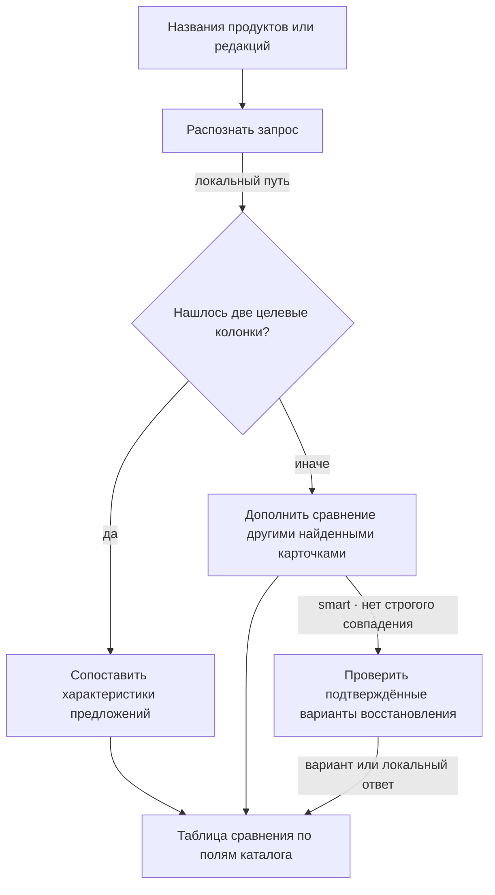

**Категоризатор.** Движок задаёт вопрос «Какой следующий шаг поиска подтверждён?» в умном режиме при пустой строгой выдаче без точного совпадения по артикулу.

Допустимые варианты — clarify, unavailable (если вариантов нет), audience (доступен обычный тариф). Минимальная вероятность выбора — 0,55. Если решение не принято, поиск продолжает локальный подбор.

**Время шагов, мс.** Быстрых запросов — 11, умных — 11, из них с возвратом к быстрому режиму — 0.

| Шаг | fast p50 | fast p95 | smart p50 | smart p95 |
|---|---:|---:|---:|---:|
| Нормализация | 0.09 | 0.12 | 0.12 | 0.17 |
| Точный артикул | 0.20 | 0.24 | 0.22 | 0.34 |
| Проверка написания | 0.13 | 1.68 | 0.17 | 0.22 |
| Сущности и параметры | 0.74 | 4.32 | 0.81 | 1.54 |
| Контекст клиента | 0.01 | 0.01 | 0.01 | 0.02 |
| Сценарий запроса | 0.03 | 0.04 | 0.03 | 0.05 |
| План поиска | 0.00 | 0.00 | 0.00 | 0.00 |
| Отбор кандидатов | 0.02 | 0.02 | 0.02 | 0.03 |
| Проверка ограничений | 0.03 | 0.04 | 0.03 | 0.08 |
| Выбор лицензии | 0.62 | 7.07 | 0.41 | 0.64 |
| Проверка категоризатором | 0.01 | 0.02 | 0.02 | 0.02 |
| Порядок карточек | 0.57 | 3.56 | 0.84 | 1.46 |
| Правила магазина | 0.01 | 0.02 | 0.01 | 0.02 |
| Сборка ответа | 0.06 | 0.08 | 0.07 | 0.08 |
| Журнал и стоимость | 0.59 | 0.63 | 0.69 | 0.78 |
| Весь запрос | 8.12 | 9.88 | 4.13 | 4.68 |

**За счёт чего быстро.** Строки сравнения берутся из уже отобранных предложений. [`compose`](../kuznitsa/plans/scenarios.py#L94)

**Что получает бизнес.** Менеджер видит, какие продукты покупатель рассматривает для одной закупки.

<a id="question"></a>

## Вопросы по лицензированию, НДС и совместимости (`question`)

Вопрос о покупке или использовании ПО. Результат для покупателя — ответ из справочника и доступные предложения.

| Запрос | Профиль | Первая карточка | Блоки ответа |
|---|---|---|---|
| входит ли р7 офис в реестр российского по | gov_clinic | Р7-Офис Профессиональный | answer, products |
| что такое cal лицензия | guest | СУБД Tantor SE | answer, products |
| чем отличается oem от box и esd | guest | Microsoft Office Home and Business | answer, products |
| нужна ли лицензия фсб чтобы купить криптопро | smb_trade | КриптоПро CSP Клиентская | answer, products |
| почему по из реестра без ндс | accounting_firm | Kaspersky Endpoint Security для бизнеса Стандартный | answer, products |


**Категоризатор.** Движок задаёт вопрос «Какова цель покупателя?» в smart при признаках неоднозначности и наличии опоры в запросе.

Допустимые варианты — question, broad, compliance, task, off_topic. Минимальная вероятность выбора — 0,55. При недостаточной уверенности или противоречии подтверждённым условиям сохраняется локальная цель. Для изменения ряда условий требуется 0,85.

**Время шагов, мс.** Быстрых запросов — 16, умных — 16, из них с возвратом к быстрому режиму — 4.

| Шаг | fast p50 | fast p95 | smart p50 | smart p95 |
|---|---:|---:|---:|---:|
| Нормализация | 0.10 | 0.17 | 0.15 | 0.25 |
| Точный артикул | 0.24 | 1.80 | 0.29 | 0.57 |
| Проверка написания | 0.17 | 1.81 | 0.22 | 0.38 |
| Сущности и параметры | 0.44 | 0.76 | 0.48 | 0.88 |
| Контекст клиента | 0.01 | 0.01 | 0.01 | 0.06 |
| Сценарий запроса | 0.03 | 0.04 | 113.22 | 368.19 |
| План поиска | 0.00 | 0.00 | 0.01 | 0.04 |
| Отбор кандидатов | 0.14 | 0.57 | 0.08 | 0.12 |
| Проверка ограничений | 0.06 | 0.16 | 0.09 | 0.15 |
| Выбор лицензии | 1.36 | 8.47 | 1.07 | 2.33 |
| Проверка категоризатором | 0.02 | 0.02 | 0.06 | 311.23 |
| Порядок карточек | 2.05 | 9.50 | 2.76 | 6.46 |
| Правила магазина | 0.02 | 1.33 | 0.03 | 0.04 |
| Сборка ответа | 0.08 | 1.78 | 0.09 | 0.11 |
| Журнал и стоимость | 1.34 | 6.65 | 1.66 | 257.53 |
| Весь запрос | 8.56 | 26.19 | 304.90 | 863.85 |

**За счёт чего быстро.** Движок извлекает готовый ответ по записи FAQ. [`KnowledgeIndex.nearest`](../kuznitsa/plans/knowledge.py#L35)

**Что получает бизнес.** Повторяющиеся вопросы показывают, какие условия стоит пояснить в карточках товара.

<a id="broad"></a>

## Широкие и многозначные запросы (`broad`)

Общее или многозначное название. Результат для покупателя — варианты уточнения запроса.

| Запрос | Профиль | Первая карточка | Блоки ответа |
|---|---|---|---|
| сертификат | guest | Техподдержка Группы Астра Стандартная | clarify, products, vendors |
| ключ | guest | Ключ-АСТРОМ | clarify, products, vendors |
| защита сети | guest | Kaspersky Industrial CyberSecurity for Nodes | clarify, products, vendors |
| софт | guest | Техподдержка РЕД СОФТ Стандартная | clarify, products, vendors |
| программы для бизнеса | guest | Project Expert Professional | clarify, products, vendors |

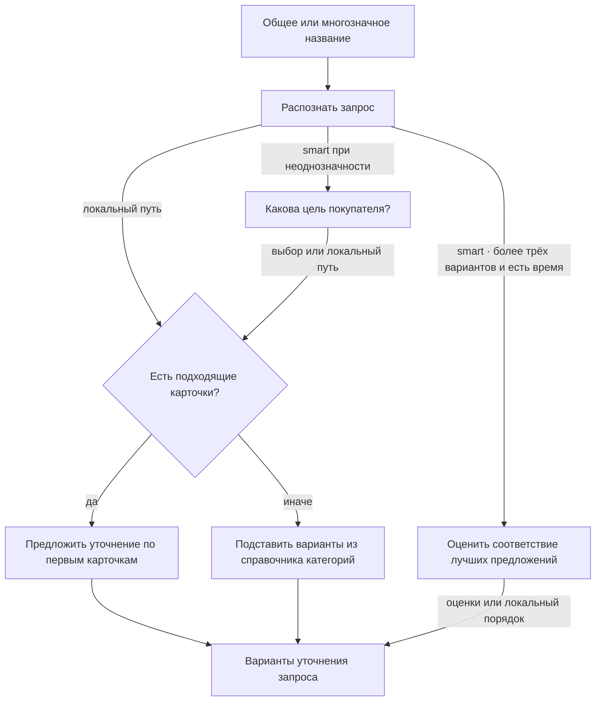

**Категоризатор.** Движок задаёт вопрос «Какова цель покупателя?» в smart при признаках неоднозначности и наличии опоры в запросе.

Допустимые варианты — broad, task, category, product, off_topic. Минимальная вероятность выбора — 0,55. При недостаточной уверенности или противоречии подтверждённым условиям сохраняется локальная цель. Для изменения ряда условий требуется 0,85.

**Время шагов, мс.** Быстрых запросов — 11, умных — 11, из них с возвратом к быстрому режиму — 0.

| Шаг | fast p50 | fast p95 | smart p50 | smart p95 |
|---|---:|---:|---:|---:|
| Нормализация | 0.10 | 0.16 | 0.12 | 0.16 |
| Точный артикул | 0.15 | 3.32 | 0.15 | 0.26 |
| Проверка написания | 0.07 | 0.12 | 0.07 | 0.15 |
| Сущности и параметры | 0.32 | 0.88 | 0.30 | 0.58 |
| Контекст клиента | 0.01 | 0.01 | 0.01 | 0.04 |
| Сценарий запроса | 0.05 | 0.59 | 0.06 | 264.77 |
| План поиска | 0.00 | 0.01 | 0.00 | 0.02 |
| Отбор кандидатов | 13.10 | 35.68 | 0.90 | 2.52 |
| Проверка ограничений | 0.08 | 0.58 | 0.10 | 0.82 |
| Выбор лицензии | 6.86 | 20.71 | 1.02 | 24.98 |
| Проверка категоризатором | 0.03 | 0.08 | 24.09 | 305.59 |
| Порядок карточек | 8.68 | 64.76 | 5.54 | 50.39 |
| Правила магазина | 0.03 | 0.16 | 0.03 | 0.54 |
| Сборка ответа | 0.13 | 3.32 | 0.13 | 0.52 |
| Журнал и стоимость | 1.80 | 6.63 | 1.85 | 3.20 |
| Весь запрос | 47.99 | 102.13 | 237.63 | 597.04 |

**За счёт чего быстро.** Уточнения строятся из уже найденных карточек. [`Engine._search`](../kuznitsa/engine.py#L246)

**Что получает бизнес.** Покупатель может продолжить поиск с конкретным названием продукта или категории.

<a id="out_of_catalog"></a>

## Ушедшие вендоры и известное ПО вне каталога (`out_of_catalog`)

Название известного отсутствующего продукта. Результат для покупателя — причина отсутствия и запрос поставки.

| Запрос | Профиль | Первая карточка | Блоки ответа |
|---|---|---|---|
| autocad купить | design_bureau | Платформа nanoCAD Базовая | not_in_catalog, analogs, lead |
| vmware vsphere лицензия | guest | zVirt Standard | not_in_catalog, analogs, lead |
| adobe photoshop для юрлиц | guest | ФотоМАСТЕР Профи | not_in_catalog, analogs, lead |
| veeam backup enterprise | guest | Кибер Бэкап Стандартный | not_in_catalog, analogs, lead |
| figma для команды | it_company | Pixso Professional | not_in_catalog, analogs, lead |


**Категоризатор.** Движок задаёт вопрос «Какой следующий шаг поиска подтверждён?» в умном режиме при пустой строгой выдаче без точного совпадения по артикулу.

Допустимые варианты — clarify, unavailable (если вариантов нет), audience (доступен обычный тариф). Минимальная вероятность выбора — 0,55. Если решение не принято, поиск продолжает локальный подбор.

**Время шагов, мс.** Быстрых запросов — 13, умных — 13, из них с возвратом к быстрому режиму — 0.

| Шаг | fast p50 | fast p95 | smart p50 | smart p95 |
|---|---:|---:|---:|---:|
| Нормализация | 0.10 | 0.15 | 0.11 | 0.19 |
| Точный артикул | 0.16 | 3.31 | 0.18 | 0.24 |
| Проверка написания | 0.09 | 0.12 | 0.12 | 0.20 |
| Сущности и параметры | 0.51 | 0.70 | 0.66 | 0.84 |
| Контекст клиента | 0.01 | 0.01 | 0.01 | 0.01 |
| Сценарий запроса | 0.03 | 0.08 | 0.04 | 0.05 |
| План поиска | 0.00 | 0.01 | 0.00 | 0.00 |
| Отбор кандидатов | 0.13 | 0.21 | 0.16 | 0.21 |
| Проверка ограничений | 0.03 | 0.04 | 0.03 | 0.04 |
| Выбор лицензии | 0.50 | 2.06 | 0.39 | 0.90 |
| Проверка категоризатором | 0.01 | 0.03 | 0.02 | 0.04 |
| Порядок карточек | 0.87 | 4.13 | 1.19 | 1.57 |
| Правила магазина | 0.01 | 0.04 | 0.02 | 0.02 |
| Сборка ответа | 0.04 | 0.07 | 0.05 | 0.07 |
| Журнал и стоимость | 0.86 | 1.20 | 1.01 | 1.23 |
| Весь запрос | 3.69 | 8.63 | 4.07 | 5.20 |

**За счёт чего быстро.** Замены ищутся по связям семейств и индексам класса. [`candidates`](../kuznitsa/plans/base.py#L14)

**Что получает бизнес.** Сохраняется интерес покупателя к отсутствующему семейству или вендору.

<a id="off_topic"></a>

## Пиратский и непрофильный трафик (`off_topic`)

Запрос вне ассортимента или пиратской копии. Результат для покупателя — пояснение и категории программ.

| Запрос | Профиль | Первая карточка | Блоки ответа |
|---|---|---|---|
| купить ноутбук для офиса | smb_trade | Без карточки | categories, clarify |
| принтер лазерный hp | guest | Без карточки | categories, clarify |
| скачать windows 11 бесплатно с ключом | guest | Без карточки | answer, categories |
| активатор kms office | guest | Без карточки | answer, categories |
| кряк для автокада | guest | Без карточки | answer, categories |

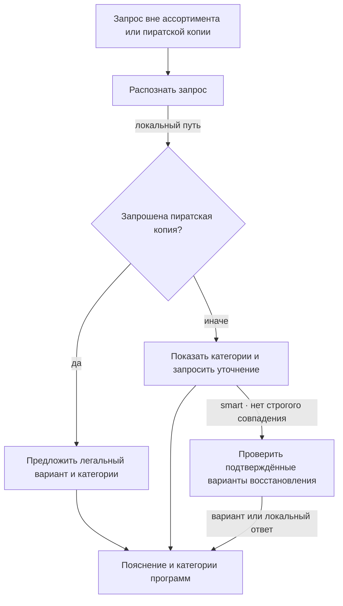

**Категоризатор.** Движок задаёт вопрос «Какой следующий шаг поиска подтверждён?» в умном режиме при пустой строгой выдаче без точного совпадения по артикулу.

Допустимые варианты — clarify, unavailable (если вариантов нет), audience (доступен обычный тариф). Минимальная вероятность выбора — 0,55. Если решение не принято, поиск продолжает локальный подбор.

**Время шагов, мс.** Быстрых запросов — 15, умных — 15, из них с возвратом к быстрому режиму — 1.

| Шаг | fast p50 | fast p95 | smart p50 | smart p95 |
|---|---:|---:|---:|---:|
| Нормализация | 0.09 | 0.13 | 0.14 | 0.19 |
| Точный артикул | 0.16 | 0.24 | 0.22 | 0.47 |
| Проверка написания | 0.93 | 8.41 | 0.25 | 0.36 |
| Сущности и параметры | 0.36 | 0.88 | 0.28 | 0.67 |
| Контекст клиента | 0.01 | 0.01 | 0.01 | 0.01 |
| Сценарий запроса | 0.04 | 17.61 | 0.05 | 1.35 |
| План поиска | 0.00 | 0.02 | 0.00 | 0.01 |
| Отбор кандидатов | 0.01 | 0.03 | 0.01 | 0.01 |
| Проверка ограничений | 0.01 | 0.02 | 225.37 | 397.02 |
| Выбор лицензии | 0.00 | 0.00 | 0.02 | 0.03 |
| Проверка категоризатором | 0.01 | 0.02 | 0.03 | 0.03 |
| Порядок карточек | 0.02 | 0.04 | 0.05 | 0.05 |
| Правила магазина | 0.01 | 0.02 | 0.01 | 0.02 |
| Сборка ответа | 0.44 | 0.52 | 0.59 | 0.75 |
| Журнал и стоимость | 0.39 | 0.54 | 0.71 | 0.98 |
| Весь запрос | 2.64 | 27.45 | 227.86 | 399.72 |

**За счёт чего быстро.** План не отбирает товарные карточки. [`scope`](../kuznitsa/plans/scenarios.py#L39)

**Что получает бизнес.** Причина пустой выдачи помогает отделить непрофильный спрос от пробелов ассортимента.

<a id="account"></a>

## Личный кабинет, мои лицензии и история заказов (`account`)

Вопрос о своих покупках или сроках. Результат для покупателя — лицензии организации или выбор профиля.

| Запрос | Профиль | Первая карточка | Блоки ответа |
|---|---|---|---|
| мои лицензии | smb_trade | Без карточки | my_licenses |
| что у нас скоро истекает | gov_clinic | Без карточки | my_licenses |
| повторить прошлый заказ антивируса | edu_university | Dr.Web Enterprise Security Suite Комплексная защита | products, answer, my_licenses |
| мои лицензии организации | smb_trade | Без карточки | my_licenses |
| покажи мои покупки | smb_trade | Без карточки | my_licenses |

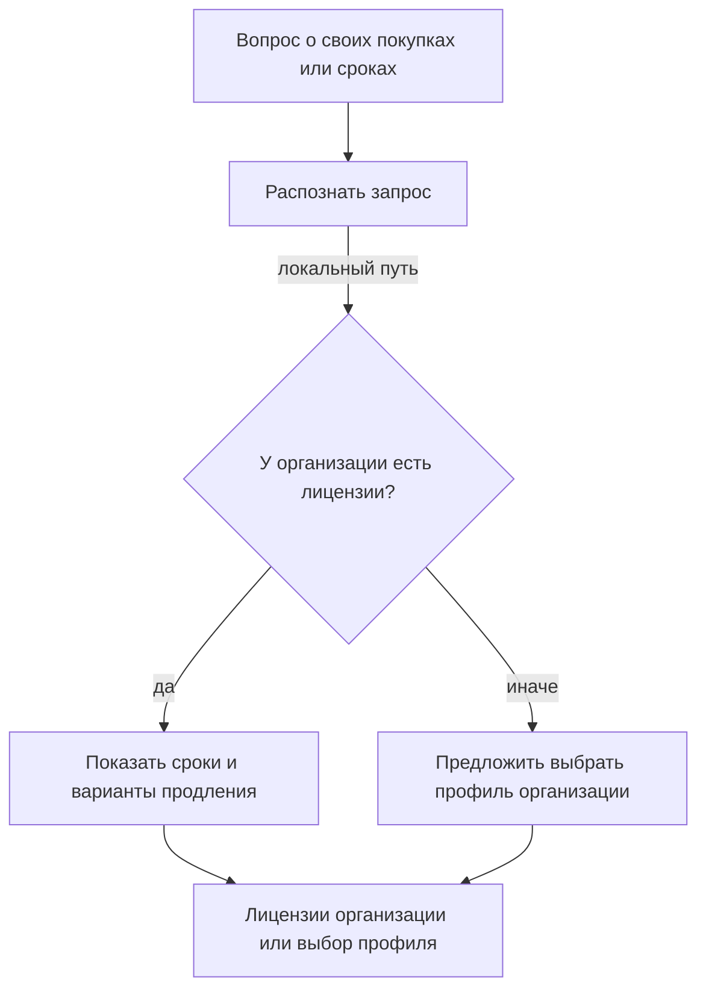

**Время шагов, мс.** Быстрых запросов — 9, умных — 9, из них с возвратом к быстрому режиму — 0.

| Шаг | fast p50 | fast p95 | smart p50 | smart p95 |
|---|---:|---:|---:|---:|
| Нормализация | 0.08 | 0.12 | 0.12 | 0.78 |
| Точный артикул | 0.16 | 0.19 | 0.18 | 0.25 |
| Проверка написания | 0.21 | 33.55 | 0.22 | 0.33 |
| Сущности и параметры | 0.16 | 0.50 | 0.15 | 0.29 |
| Контекст клиента | 0.01 | 0.01 | 0.01 | 0.01 |
| Сценарий запроса | 0.02 | 0.04 | 0.03 | 0.04 |
| План поиска | 0.00 | 0.00 | 0.00 | 0.00 |
| Отбор кандидатов | 0.01 | 0.01 | 0.01 | 0.01 |
| Проверка ограничений | 0.01 | 0.02 | 0.01 | 0.02 |
| Выбор лицензии | 0.00 | 0.00 | 0.00 | 0.00 |
| Проверка категоризатором | 0.01 | 0.02 | 0.01 | 0.02 |
| Порядок карточек | 0.02 | 0.04 | 0.02 | 0.03 |
| Правила магазина | 0.01 | 0.01 | 0.01 | 0.01 |
| Сборка ответа | 0.42 | 5.12 | 0.47 | 0.60 |
| Журнал и стоимость | 0.46 | 0.63 | 0.47 | 2.97 |
| Весь запрос | 1.48 | 38.64 | 1.99 | 4.84 |

**За счёт чего быстро.** Список покупок читается из загруженного профиля. [`compose`](../kuznitsa/plans/scenarios.py#L94)

**Что получает бизнес.** Клиент может самостоятельно сверить сроки лицензий перед продлением.

<a id="service"></a>

## Услуги обучения, сертификации и техподдержки (`service`)

Обучение, внедрение или поддержка. Результат для покупателя — предложения услуг или обращение к специалисту.

| Запрос | Профиль | Первая карточка | Блоки ответа |
|---|---|---|---|
| курсы администрирования ред ос | guest | Курсы РЕД ОС Администрирование | services |
| техподдержка астра линукс премиум | gov_clinic | Техподдержка Группы Астра Стандартная | services |
| курсы администрирования astra linux | guest | Курсы Astra Linux ALD Pro и Брест | services |
| обучение работе с ред ос | guest | Курсы РЕД ОС Администрирование | services |
| курсы по криптопро | guest | Курсы Astra Linux ALD Pro и Брест | services |

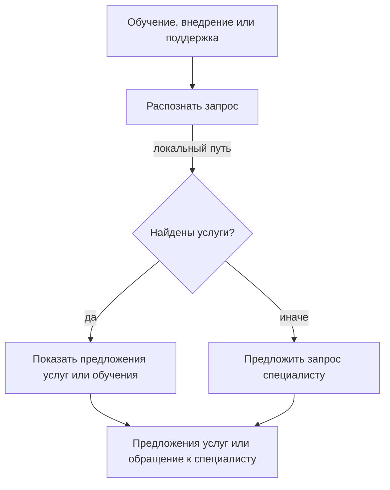

**Время шагов, мс.** Быстрых запросов — 8, умных — 8, из них с возвратом к быстрому режиму — 0.

| Шаг | fast p50 | fast p95 | smart p50 | smart p95 |
|---|---:|---:|---:|---:|
| Нормализация | 0.08 | 0.13 | 0.10 | 0.18 |
| Точный артикул | 0.18 | 0.28 | 0.18 | 0.27 |
| Проверка написания | 0.12 | 0.15 | 0.12 | 0.15 |
| Сущности и параметры | 0.68 | 1.08 | 0.66 | 0.99 |
| Контекст клиента | 0.01 | 0.01 | 0.01 | 0.02 |
| Сценарий запроса | 0.02 | 0.13 | 0.03 | 0.06 |
| План поиска | 0.00 | 0.00 | 0.00 | 0.00 |
| Отбор кандидатов | 0.03 | 0.04 | 0.03 | 0.05 |
| Проверка ограничений | 0.04 | 0.28 | 0.06 | 0.09 |
| Выбор лицензии | 0.25 | 0.93 | 0.21 | 0.52 |
| Проверка категоризатором | 0.01 | 0.02 | 0.02 | 0.03 |
| Порядок карточек | 0.32 | 2.54 | 0.45 | 1.44 |
| Правила магазина | 0.01 | 0.02 | 0.01 | 0.04 |
| Сборка ответа | 0.03 | 0.04 | 0.04 | 0.06 |
| Журнал и стоимость | 0.55 | 0.96 | 0.58 | 1.00 |
| Весь запрос | 2.74 | 6.14 | 2.77 | 4.45 |

**За счёт чего быстро.** Кандидаты берутся из категорий обучения и поддержки. [`scope`](../kuznitsa/plans/scenarios.py#L39)

**Что получает бизнес.** Спрос на услуги можно рассматривать отдельно от продажи лицензий.

<a id="promo"></a>

## Пилоты, скидки и спецпредложения для юрлиц (`promo`)

Запрос пилота, скидки или акции. Результат для покупателя — акция с подтверждением или обычные условия.

| Запрос | Профиль | Первая карточка | Блоки ответа |
|---|---|---|---|
| пилот астра линукс бесплатно | guest | Astra Linux Special Edition «Воронеж» | answer, products |
| скидки на антивирусы для юрлиц | smb_trade | Kaspersky Small Office Security | promo |
| скидка на криптопро | guest | КриптоПро CSP Клиентская | promo |
| пилот астра линукс | guest | Astra Linux Special Edition «Воронеж» | answer, products |
| пробная версия р7 офис | guest | Р7-Офис Профессиональный | promo |

```mermaid
flowchart TD
    n_input["Запрос пилота, скидки или акции"]
    n_parse["Распознать запрос"]
    n_d{"Есть карточки с подтверждённой акцией?"}
    n_a["Показать акционные предложения"]
    n_b["Объяснить отсутствие акции и показать доступные условия"]
    n_result["Акция с подтверждением или обычные условия"]
    n_input --> n_parse
    n_parse -->|локальный путь| n_d
    n_d -->|да| n_a
    n_d -->|иначе| n_b
    n_a --> n_result
    n_b --> n_result
```

**Время шагов, мс.** Быстрых запросов — 7, умных — 7, из них с возвратом к быстрому режиму — 0.

| Шаг | fast p50 | fast p95 | smart p50 | smart p95 |
|---|---:|---:|---:|---:|
| Нормализация | 0.08 | 0.10 | 0.07 | 0.18 |
| Точный артикул | 0.16 | 0.22 | 0.15 | 0.24 |
| Проверка написания | 0.12 | 8.50 | 0.15 | 0.22 |
| Сущности и параметры | 0.65 | 2.56 | 0.75 | 1.13 |
| Контекст клиента | 0.01 | 0.01 | 0.01 | 0.01 |
| Сценарий запроса | 0.02 | 0.04 | 0.03 | 0.03 |
| План поиска | 0.00 | 0.00 | 0.00 | 0.00 |
| Отбор кандидатов | 0.05 | 17.11 | 0.04 | 0.18 |
| Проверка ограничений | 0.02 | 0.05 | 0.04 | 0.05 |
| Выбор лицензии | 0.22 | 0.98 | 0.27 | 0.48 |
| Проверка категоризатором | 0.01 | 0.02 | 0.02 | 0.02 |
| Порядок карточек | 0.46 | 3.20 | 0.55 | 1.77 |
| Правила магазина | 0.01 | 0.05 | 0.01 | 0.05 |
| Сборка ответа | 0.04 | 0.06 | 0.04 | 0.06 |
| Журнал и стоимость | 0.61 | 1.06 | 0.69 | 1.00 |
| Весь запрос | 2.61 | 28.58 | 3.11 | 4.96 |

**За счёт чего быстро.** Признак акции проверяется на найденных карточках. [`compose`](../kuznitsa/plans/scenarios.py#L94)

**Что получает бизнес.** Покупатель видит льготные предложения только при наличии соответствующего предложения в каталоге.

<a id="suggest"></a>

## Подсказки при наборе (`suggest`)

Поиск предлагает продолжения ещё до отправки запроса.

| Пример | Проверенный результат |
|---|---|
| касп | Kaspersky Endpoint Security для бизнеса · Kaspersky Small Office Security · Kaspersky ASAP |
| крипто | Signal-COM CSP / УЦ «Нотариус» · КриптоПро CSP · КриптоАРМ ГОСТ |
| астр | Астрал-ЭТ / Электронная подпись (Калуга Астрал) · Астрал.ЭДО / Доки (Калуга Астрал) · Астрал Отчёт (Калуга Астрал) |

```mermaid
flowchart TD
    n_0["Начало запроса"]
    n_1{"Есть совпадение по префиксу?"}
    n_2["Проверить раскладку, транслитерацию и опечатки"]
    n_3["Группы подсказок, артикулы и лицензии клиента"]
    n_0 --> n_1
    n_1 -->|да| n_3
    n_1 -->|нет| n_2
    n_2 --> n_3
```

**За счёт чего быстро.** Двоичный поиск находит начало префикса в отсортированном словаре. [`SuggestIndex.prefix`](../kuznitsa/suggest/index.py#L104)

**Что получает бизнес.** Покупатель может перейти к нужному продукту до отправки полного запроса.

<a id="spec_file_kp"></a>

<a id="spec_file"></a>

## Спецификация файлом → КП (`spec_file`)

Закупщик загружает файл, сверяет строки и скачивает коммерческое предложение.

| Пример | Проверенный результат |
|---|---|
| [request.csv](quote_examples/request.csv) | Найдено 2 из 2 позиций. КП KP-20261121-s_3c2f.xlsx. Загрузка и экспорт заняли 745.33 мс. |
| [request.txt](quote_examples/request.txt) | Найдено 3 из 3 позиций. КП KP-20261121-s_8ce5.xlsx. Загрузка и экспорт заняли 40.49 мс. |
| [request-1c.xlsx](quote_examples/request-1c.xlsx) | Найдено 2 из 2 позиций. КП KP-20261121-s_bbfc.xlsx. Загрузка и экспорт заняли 104.58 мс. |

```mermaid
flowchart TD
    n_0["Загрузить XLSX, CSV, TSV или TXT"]
    n_1["Разобрать строки, артикулы и количество"]
    n_2{"Указанный артикул подтверждён?"}
    n_3["Рассчитать количество упаковок и цену"]
    n_4["Отметить позицию для согласования"]
    n_5["Скачать сохранённую смету по search_id в XLSX или CSV"]
    n_search["Подобрать позиции и сопоставить строки ответа"]
    n_0 --> n_1
    n_search --> n_2
    n_2 -->|да| n_3
    n_2 -->|нет| n_4
    n_3 --> n_5
    n_4 --> n_5
    n_search -->|без артикула · подбор по описанию| n_5
    n_1 --> n_search
```

**За счёт чего быстро.** Для свежей спецификации экспорт использует сохранённый расчёт. Архивный запрос с сокращённой записью пересчитывается. [`make_export`](../kuznitsa/quote/export.py#L108)

**Что получает бизнес.** Менеджер видит позиции, по которым ещё нужно согласовать замену.

<a id="voice_words"></a>

<a id="voice"></a>

## Голос и числа словами (`voice`)

Браузер передаёт распознанный текст в обычный поиск.

| Пример | Проверенный результат |
|---|---|
| антивирус на тридцать компьютеров | Распознано количество 30. Первая карточка — Kaspersky Endpoint Security для бизнеса Стандартный. |
| Р7 офис на двадцать пять мест | Распознано количество 25. Первая карточка — Р7-Офис Профессиональный. |
| КриптоПро CSP на пять рабочих мест | Распознано количество 5. Первая карточка — КриптоПро CSP Клиентская. |

```mermaid
flowchart TD
    n_0["Нажать микрофон в поддерживаемом браузере"]
    n_1["Распознать русскую речь и передать текст"]
    n_2["Преобразовать словесное количество"]
    n_3["Подобрать лицензию на указанное количество"]
    n_0 --> n_1
    n_1 --> n_2
    n_2 --> n_3
```

**За счёт чего быстро.** После распознавания речи работает обычный разбор текста. [`spoken_numbers`](../kuznitsa/understand/quantities.py#L67)

**Что получает бизнес.** Покупатель может продиктовать объём закупки.

<a id="widget"></a>

## Поиск на сайте партнёра (`widget`)

Встроенная форма использует тот же поисковый API, что и витрина.

| Пример | Проверенный результат |
|---|---|
| КриптоПро CSP | fast · КриптоПро CSP Клиентская |
| КриптоПро CSP | smart · КриптоПро CSP Клиентская |
| KL4867RAQFR | fast · Kaspersky Endpoint Security для бизнеса Расширенный |
| KL4867RAQFR | smart · Kaspersky Endpoint Security для бизнеса Расширенный |
| Microsoft Windows 11 Pro | fast · Microsoft Windows 11 Pro |
| Microsoft Windows 11 Pro | smart · Microsoft Windows 11 Pro |

```mermaid
flowchart TD
    n_0["Строка поиска на странице партнёра"]
    n_1["Передать запрос, профиль, сессию и режим в /api/search"]
    n_2["Выполнить поиск"]
    n_3["Показать блоки и записать событие показа"]
    n_0 --> n_1
    n_1 --> n_2
    n_2 --> n_3
```

**За счёт чего быстро.** Виджет использует загруженный индекс общего движка. [`Engine.search`](../kuznitsa/engine.py#L197)

**Что получает бизнес.** Клиент видит результат на странице партнёра и может продолжить в каталоге.

<a id="okved"></a>

## Подбор по ОКВЭД (`okved`)

Движок сопоставляет номер с отраслью и собирает комплект.

| Пример | Проверенный результат |
|---|---|
| оквэд 86.23 | Стоматология и частная медицинская клиника |
| оквэд 49.41 | Транспорт, грузоперевозки и логистика |
| оквэд 10.71 | Пищевое производство и переработка продуктов |

```mermaid
flowchart TD
    n_0["Код деятельности организации"]
    n_1{"Есть точный или более короткий префикс?"}
    n_2["Отрасль из справочника ОКВЭД"]
    n_3["Комплект по слотам отрасли"]
    n_4["Уточнить отрасль"]
    n_0 --> n_1
    n_1 -->|да| n_2
    n_2 --> n_3
    n_1 -->|нет| n_4
```

**За счёт чего быстро.** Словарь проверяется от полного кода к короткому. [`KitIndex.pick`](../kuznitsa/understand/kits.py#L108)

**Что получает бизнес.** Закупщик может начать подбор с известного кода организации.

<a id="kit_parent"></a>

## Частный и общий комплект (`kit_parent`)

Из узкого отраслевого или ролевого комплекта можно перейти к общему.

| Пример | Проверенный результат |
|---|---|
| софт для учителя школы | Учитель школы (рабочее место педагога) → Учитель / преподаватель вуза |
| софт для преподавателя вуза | Преподаватель вуза и кафедры → Учитель / преподаватель вуза |
| софт для регистратора клиники | Регистратор и администратор медицинской клиники → Врач / АРМ медицинского работника |

```mermaid
flowchart TD
    n_0["Запрос профессии или отрасли"]
    n_1["Подобрать слоты конкретного комплекта"]
    n_2{"Есть запись parent в справочнике?"}
    n_3["Добавить название и запрос родительского комплекта"]
    n_4["Вернуть выбранный комплект"]
    n_0 --> n_1
    n_1 --> n_2
    n_2 -->|да| n_3
    n_2 -->|нет| n_4
```

**За счёт чего быстро.** Родитель извлекается по идентификатору из того же справочника. Точные названия и веса слов подготовлены в KitIndex до запроса. [`compose`](../kuznitsa/plans/scenarios.py#L94)

**Что получает бизнес.** Можно расширить подбор от узкой специализации до общего профиля.

<a id="naive"></a>

## Обычный поиск по словам (`naive`)

Каждый результат соответствует отдельной прайсовой позиции.

| Пример | Проверенный результат |
|---|---|
| антивирус на 30 пк | Обычный поиск — 0 предложений, быстрый — 11 сгруппированных карточек. |
| КриптоПро CSP | Обычный поиск — 125 предложений, быстрый — 2 сгруппированных карточек. |
| rfcgthcrbq | Обычный поиск — 0 предложений, быстрый — 19 сгруппированных карточек. |

```mermaid
flowchart TD
    n_0["Запрос в режиме naive"]
    n_1["Пересечь списки предложений для всех значимых слов"]
    n_2["Отсортировать по популярности"]
    n_3["Вывести страницу отдельных предложений"]
    n_0 --> n_1
    n_1 --> n_2
    n_2 --> n_3
```

**За счёт чего быстро.** Обратный индекс предложений строится при открытии каталога. [`StoreIndex.match`](../kuznitsa/plans/naive.py#L41)

**Что получает бизнес.** Бизнес получает базовый результат для сравнения с подбором по намерению.

<a id="smart"></a>

## Умный режим и кэш Jev (`smart`)

Jev выбирает из вариантов, подготовленных движком для конкретного запроса.

Слева — первая карточка быстрого поиска, справа — умного. Для этих запросов в dev задан список подходящих продуктов. В каждом примере Jev поднял продукт из этого списка на первое место, а ответ smart прошёл все проверки строки dev.

| Пример | Проверенный результат |
|---|---|
| виртуализация на 4 сокета | РЕД Виртуализация → Basis Dynamix Standard. Расход $0.00000000, решений из кэша — 1. |
| запретить копирование на флешки | Dallas Lock 8.0-C → Kaspersky Endpoint Security для бизнеса Стандартный. Расход $0.00000000, решений из кэша — 3. |
| подписывать кадровые документы с удаленщиками | СБИС Saby ЭДО → 1С:Кабинет сотрудника Локальный. Расход $0.00000000, решений из кэша — 2. |

```mermaid
flowchart TD
    n_0["Запрос в режиме smart"]
    n_1{"Нужна проверка моделью?"}
    n_2["Подготовить вопрос и допустимые ответы"]
    n_3{"Есть решение для модели, состояния и вопросов?"}
    n_4["Отправить закрытый вопрос в Decisions"]
    n_5{"Можно применить результат по правилам этапа?"}
    n_6["Оставить локальную оценку или предложить уточнение"]
    n_7["Выдача, трасса и стоимость"]
    n_goal["Цель и класс программы"]
    n_kit["Профессия или отрасль"]
    n_recovery["Уточнение при пустой выдаче"]
    n_rerank["Соответствие предложений"]
    n_0 --> n_1
    n_1 -->|нет| n_7
    n_1 -->|да| n_2
    n_3 -->|кэш| n_5
    n_3 -->|нет · бюджет доступен| n_4
    n_3 -->|запрос заблокирован| n_6
    n_4 -->|ответ| n_5
    n_4 -->|ошибка или дедлайн| n_6
    n_5 -->|да| n_7
    n_5 -->|нет| n_6
    n_6 --> n_7
    n_2 -->|intent| n_goal
    n_goal --> n_3
    n_2 -->|entities| n_kit
    n_kit --> n_3
    n_2 -->|filters| n_recovery
    n_recovery --> n_3
    n_2 -->|rerank| n_rerank
    n_rerank --> n_3
```

- **Цель и класс программы.** Исходная допустимая цель, broad и off_topic; для предметного подбора также task, category, product. Для вопроса — compliance и task. Класс — до 6 кандидатов и none, FAQ — до 5 и none. [`questions_for`](../kuznitsa/llm/advice.py#L19)
- **Профессия или отрасль.** До восьми ID из списка локальных кандидатов и none. Применить выбранный комплект при вероятности от 0,55. [`KitIndex.ask`](../kuznitsa/understand/kits.py#L214)
- **Уточнение при пустой выдаче.** Только доступные qty, audience, category_ID и clarify. Без вариантов добавляется unavailable. Порог 0,55. [`ask_recovery`](../kuznitsa/llm/recovery.py#L4)
- **Соответствие предложений.** Для каждой карточки yes, part, no. До 30 карточек партиями по 20 при старте до 400 мс. При no ≥ 0,85 оценка ограничивается сверху; в остальных случаях учитывается разность вероятностей yes и no. [`Decisions.rerank`](../kuznitsa/llm/decisions.py#L128)

**Категоризатор.** Движок задаёт вопрос «Какова цель покупателя?» в smart при неоднозначной цели с данными в пользу нескольких трактовок.

Допустимые варианты — исходная допустимая цель, broad, off_topic, task/category/product или compliance по исходной цели. Минимальная вероятность выбора — 0,55. При низкой вероятности сохраняются локальные условия. При ошибке запроса выдача помечается fast. Для реранка действуют отдельные правила.

**За счёт чего быстро.** SQLite хранит решения. Общий дедлайн ожидания Jev — 600 мс от начала поиска. [`Decisions.request`](../kuznitsa/llm/decisions.py#L51)

**Что получает бизнес.** В журнале можно сопоставить пользу модели с расходами.

<a id="priorities"></a>

## Приоритеты направлений (`priorities`)

Предпросмотр показывает, как правило изменило бы порядок уже подобранных лицензий.

Пробное правило «Отечественные антивирусы для госзаказчиков» действует для государственного профиля. Оба запуска получают один запрос. Сначала Engine.preview получает пустой список правил, затем — правило с прибавкой 40 для отечественных антивирусов и равными весами наличия и низкой цены. Полное время включает подготовку правила, а business — весь шаг бизнес-ранжирования.

| Пример | Проверенный результат |
|---|---|
| антивирус | Kaspersky Endpoint Security для бизнеса Расширенный → Dr.Web Enterprise Security Suite Защита рабочих станций. Под правило попало 7 карточек, сменили позицию 7. Шаг business — 1.17 мс. |
| антивирус на 30 пк | Kaspersky Endpoint Security для бизнеса Total → Kaspersky Endpoint Security для бизнеса Total. Под правило попало 5 карточек, сменили позицию 0. Шаг business — 0.77 мс. |
| антивирус для организации | Kaspersky Endpoint Security для бизнеса Расширенный → Dr.Web Enterprise Security Suite Защита рабочих станций. Под правило попало 7 карточек, сменили позицию 7. Шаг business — 0.94 мс. |

```mermaid
flowchart TD
    n_request["Запрос и пробное правило"]
    n_compile["Подготовить область и цели правила"]
    n_offers["Выбрать допустимые лицензии"]
    n_match{"Правило применимо к выбранным предложениям?"}
    n_rank["Применить поправку внутри полосы"]
    n_same["Сохранить исходный порядок"]
    n_preview["Показать до и после"]
    n_request --> n_compile
    n_compile --> n_offers
    n_offers --> n_match
    n_match -->|да| n_rank
    n_match -->|нет| n_same
    n_rank --> n_preview
    n_same --> n_preview
```

| Режим | Запросов | Граница замера | p50, мс | p95, мс |
|---|---:|---|---:|---:|
| fast | 3 | Полный предпросмотр | 2.88 | 3.12 |
| fast | 3 | business | 0.94 | 1.15 |

**За счёт чего быстро.** Цели ограничиваются множествами карточек из индексов. В обычном поиске скомпилированные правила переиспользуются до смены версии. [`compile_rules`](../kuznitsa/rank/priorities.py#L34)

**Что получает бизнес.** Менеджер проверяет эффект продвижения перед публикацией правила.

<a id="refine"></a>

## Уточнение аудитории и линейки (`refine`)

Проект схемы. После быстрого разбора поиск уточняет, для кого и для какой среды покупают программу.

Примеры и замеры появятся, когда движок подтвердит этот путь в быстром и умном режимах.

```mermaid
flowchart TD
    n_q["Запрос, профиль и быстрый разбор"]
    n_need{"Есть повод уточнить?"}
    n_dict["Словарная аудитория и платформа"]
    n_jev["Для кого ПО и какая линейка подходит?"]
    n_accept{"Уверенность не ниже 0,55?"}
    n_base["Оставить быстрый результат"]
    n_out["Метка аудитории и фильтр линейки"]
    n_q --> n_need
    n_need -->|fast| n_dict
    n_need -->|smart · да| n_jev
    n_need -->|smart · нет| n_base
    n_jev -->|решение| n_accept
    n_jev -->|тайм-аут| n_base
    n_accept -->|да| n_out
    n_accept -->|нет| n_base
    n_dict --> n_out
    n_base --> n_out
```

**Категоризатор.** Движок задаёт вопрос «Для кого продукт и какая линейка подходит?» при неоднозначном запросе в умном режиме.

Допустимые варианты — home, micro_office, business, enterprise, gov, edu, server, mobile, industrial, none, line: до 8 ID из каталога или none. Минимальная вероятность выбора — 0,55. Сохранить результат быстрого разбора.

**За счёт чего быстро.** Быстрый режим использует словарь. Умный режим кэширует решение по нормализованному запросу, предлагает до восьми линеек и ждёт ответ до 600 мс. [`Engine._search`](../kuznitsa/engine.py#L246)

**Что получает бизнес.** Жаргон клиента помогает отделить домашнюю, серверную и корпоративную закупку.

<a id="not_sold"></a>

## Нет в продаже — ближайшие варианты (`not_sold`)

Проект схемы. Покупатель видит причину отсутствия и может перейти к доступной замене.

Примеры и замеры появятся, когда движок подтвердит этот путь в быстром и умном режимах.

```mermaid
flowchart TD
    n_q["Понятная потребность без товара в продаже"]
    n_why["Объяснить причину"]
    n_kb{"Есть продаваемая замена по базе знаний?"}
    n_vendor{"Есть младшая бизнес-линейка того же вендора?"}
    n_cat["Найти предложение того же раздела"]
    n_alt["Собрать блок analogs"]
    n_faq{"Есть подходящий FAQ?"}
    n_link["Добавить ссылку на ответ"]
    n_out["Объяснение и варианты покупки"]
    n_q --> n_why
    n_why --> n_kb
    n_kb -->|да| n_alt
    n_kb -->|нет| n_vendor
    n_vendor -->|да| n_alt
    n_vendor -->|нет| n_cat
    n_cat --> n_alt
    n_alt --> n_faq
    n_faq -->|да| n_link
    n_link --> n_out
    n_faq -->|нет| n_out
```

**За счёт чего быстро.** Сначала проверяются известные связи и ограниченный ассортимент вендора или раздела. [`Engine._search`](../kuznitsa/engine.py#L246)

**Что получает бизнес.** Спрос на отсутствующее ПО остаётся виден в аналитике и ведёт к доступным альтернативам.
