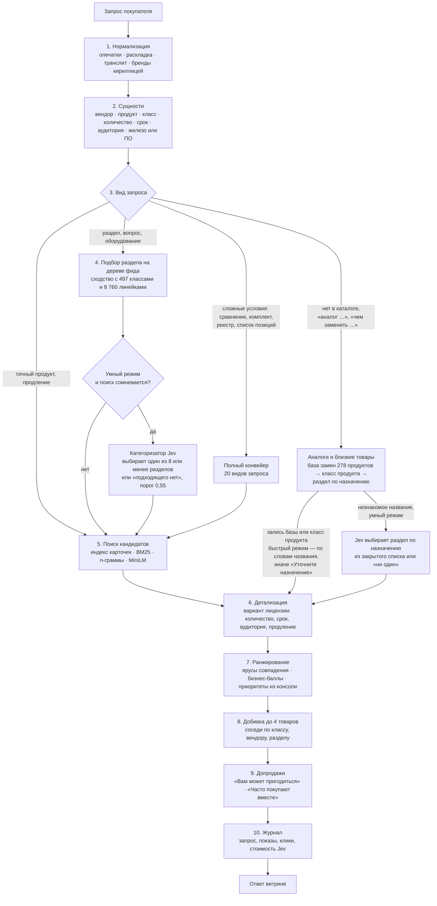

# Как работает умный поиск «Кузницы Softline»

Команда AiXenix. Хакатон «ИИкузница», трек «Аналитик данных», задача «Умный поиск на сайте» store.softline.ru. Здесь описана чистовая версия 1.0, которая работает на настоящем фиде магазина. Документ написан для владельца проекта и для жюри: он объясняет, что происходит с запросом от ввода до ответа и почему ответ получается именно таким.

Числа взяты из итогового замера 26.11.2026 на финальном коде дня. Закрытый набор состоит из 400 запросов покупателя по настоящему фиду. Разметку делал независимый «организатор», который не видел нашего кода. Утверждения, которые пока не подтверждены кодом или замером, собраны в конце документа, в разделе «Что ещё проверить».

---

## В двух словах

Покупатель пишет так, как привык: «касп», «майкрософт офис», «сервер», «что использовать против вирусов?». Сначала поиск переводит запрос на язык каталога: исправляет опечатки и раскладку, заменяет русское написание бренда латинским. Затем он определяет, что нужно покупателю: конкретный продукт, раздел, оборудование, продление или ответ на вопрос. После этого поиск находит карточки в фиде и в каждой выбирает подходящий вариант лицензии. Точные совпадения идут первыми. Если нужного продукта в каталоге нет, поиск честно говорит об этом и предлагает аналоги по назначению. Если найдено меньше четырёх товаров, он добавляет похожие. Затем вставляет одну-две уместные допродажи и указывает, зачем они нужны. Всё это работает локально и занимает миллисекунды.

На закрытом наборе из 400 запросов верная выдача составила **91,0 %** в быстром режиме и **94,2 %** в умном. Утром того же дня было 65,0 % и 68,0 %.

Внешний категоризатор Jev подключается только в умном режиме и только если поиск сомневается. Даже тогда Jev не пишет текст и не выдумывает товары. Он выбирает один вариант из списка, который составил сам поиск.

---

## На каких данных работает поиск

| Что | Объём и правила |
|---|---|
| Фид магазина (YML) | 136 040 предложений, 1 232 вендора. 9 311 разделов в три уровня: 54 корня → 497 классов → 8 760 линеек |
| Карточка товара | Одна карточка соответствует одной странице продукта (`group_id`), предложения группы — её варианты: срок, число мест, тип лицензии. Оборудование без группы объединяется по вендору и модели. На стенде получается **11 713 карточек** |
| Наличие и цена | 91 тыс. предложений имеют `available=false`, на витрине — «Под заказ». У значительной части предложений цена 0, на витрине — «Цена по запросу». «Акция −N %» показывается только при `0 < price < oldprice`. Цену конкурентов не сравниваем: внешних данных о ценах нет |
| Домен карточки | Оборудование, ПО, услуга или облако — по корню раздела |
| База знаний | Словари жаргона и брендов: в ходе 10 добавлено 607 терминов, из них 449 — бренды и продукты кириллицей, 158 — жаргонные названия оборудования. Ещё в базе 18 подсказок «оборудование или ПО», роли, задачи и 233 правила допродаж |
| База аналогов | 278 продуктов (185 вне каталога, 93 в каталоге), 1 207 замен, из них 542 российские. Все замены сверены с карточками каталога. Подробнее — в разделе «Аналоги и близкие товары» |
| Модель смысла | MiniLM, работает локально на процессоре. По ней считается сходство запроса с классами и линейками фида |

При старте служба строит индексы. С готовыми векторами открытие снимка занимает 153–163 с, процесс занимает около 2,9 ГБ памяти. Скорость поиска ниже измерена после прогрева.

---

## Схема пути запроса



**Три пути внутри.** Типовые запросы проходят **коротким путём по фиду**: продукт, раздел, оборудование, вопрос, количество, продление. Отсутствующие продукты и просьбы подобрать замену («аналог TeamViewer», «чем заменить Microsoft Office») идут в **подбор аналогов** (раздел «Аналоги и близкие товары»). Остальные запросы уходят в **полный конвейер**. Это запросы со сравнением, комплектом, реестром, сортировкой или фильтрами, списки из нескольких строк, а также запросы, по которым короткий путь ничего не нашёл. Полный конвейер различает 20 видов запроса и сам исправляет раскладку и опечатки. Шаги 8–10 у всех путей общие.

**Сколько это длится.** В итоговом прогоне после прогрева медиана — 7 мс, p95 — **54 мс** в быстром режиме и **346 мс** в умном. Время каждого шага показывает трасса: она открывается под шестерёнкой витрины, пункт «Трасса». Ниже для каждого шага указан порядок величин.

---

## Шаги по порядку

### Шаг 1. Нормализация

**Что делает.** Переводит запрос на язык каталога:

- приводит к нижнему регистру и заменяет «ё» на «е»;
- русское написание бренда или продукта заменяет латинским из словаря базы знаний: «фотошоп элементс» → Photoshop Elements, «ансибл» → Ansible, «спешл эдишн» → Special Edition. Замена делается по границам слов, длинная фраза важнее короткой;
- раскрывает короткие псевдонимы: «винда» → Microsoft Windows, «астра линукс» → Astra Linux, «крипто про» → КриптоПро, «антивирь» → антивирус, «макс патрол» → MaxPatrol, «мдаемон» → MDaemon;
- исправляет опечатки. Если слова длиной от 5 букв нет в каталоге, оно заменяется ближайшим словом из названий фида при сходстве от 85 %;
- сопоставляет русское произношение со словами реальных названий и вендоров: «майкрософт» → Microsoft, «офис» → Office;
- исправляет раскладку: «rfcg» → «касп». Это делают подсказки при наборе и полный конвейер;
- переводит числа словами в цифры: «тридцать компьютеров» → 30 (в полном конвейере).

**Данные.** Словари базы знаний, словарь слов из названий фида, индекс по звучанию, таблица раскладки.

**Время.** Доли миллисекунды — миллисекунды. Шаг входит в 7 мс медианы поиска.

**Если ошибся.** Исправление не скрывается: в ответе сохраняются исходная и исправленная формы, в подсказках появляется строка «Возможно, вы искали». Латинское слово, далёкое от исправления, остаётся как есть. Общие слова, которые дают ложные срабатывания, в словарь специально не добавлены: «принтер», «сервер», «монитор», «сканер» без бренда. Иначе сломались бы «сканер-вс», «сервер 1с» и «SQL Monitor». Если короткий путь ничего не нашёл, полный конвейер разбирает запрос заново со своей проверкой написания.

### Шаг 2. Распознавание сущностей

**Что делает.** Выделяет из запроса:

| Сущность | Как распознаётся | Пример |
|---|---|---|
| Вендор | имена вендоров фида и их русские названия из базы знаний | «касперский», «майкрософт» |
| Продукт, линейка | название страницы продукта или линейки фида | «kaspersky small office security» |
| Класс | название раздела фида, в том числе в другой форме слова | «антивирус для дома» → «Антивирусы для дома» |
| Количество | «на 10 пк», «25 пользователей», «50 узлов» → число и единица: пользователь или устройство | «на 10 пк» |
| Срок | «1 год», «12 мес.» | «на 2 года» |
| Аудитория | «для дома», «для семьи» → дом; «компания», «организация», «офис», «бухгалтер» → бизнес; «школа», «университет» → образование; «госучреждение» → государство | «для дома» |
| Операция | «продлить», «продление» | «продлить касперский» |
| Оборудование или ПО | слова «сервер», «ноутбук», «моноблок», «принтер», «коммутатор», «монитор», «ИБП»; 18 подсказок оборудования; жаргон: «ноут», «сервак», «комп», «мфушка», «свитч», «моник», «бесперебойник» и ещё 158 терминов | «сервер», «комп» |
| Роль | слово после «для» или «в» рядом с оборудованием | «ноутбук для бухгалтера» |

Полный конвейер распознаёт ещё артикул, редакцию, версию, платформу, отрасль, требования реестра и ФСТЭК, бюджет и исключения («кроме…»).

**Данные.** Словарь вендоров фида и базы знаний, названия 497 классов, подсказки оборудования, роли из базы знаний, шаблоны количества и срока.

**Время.** Миллисекунды.

**Если ошибся.** Распознанное видно в «Понято так» под шестерёнкой и в метках над выдачей. Если вместо ПО показано оборудование, рядом с выдачей есть кнопка «Искали ПО для …?». Когда в каталоге нет предложения с нужным количеством или сроком, покупатель видит пояснение и близкие варианты (шаг 6).

### Шаг 3. Вид запроса (сценарий)

**Что делает.** По найденным сущностям и словам выбирает сценарий ответа.

| Сценарий | Признак | Что покажем |
|---|---|---|
| Точный продукт | слова запроса совпали с названием страницы продукта | карточки продукта и блок «Часто покупают вместе» |
| Раздел | запрос совпал с названием класса или сочетанием «вендор + класс» | раздел, при необходимости только товары этого вендора |
| Вопрос или задача | «что использовать…», «чем защитить…», «как проверить…», «программа для…», глагол на -ть/-ться. Глагол связывается с разделом: «перевести» → переводчики, «вернуть стёртые» → восстановление данных, «блок-схема» → схемы и диаграммы, «удалённая помощь» → удалённый доступ | раздел (шаг 4) и короткая строка из базы знаний |
| Оборудование или ПО | голое название оборудования, его жаргон или «оборудование для роли» означают оборудование. «Сервер 1с», «windows server», «антивирус для сервера», «ПО для сервера» означают ПО | для оборудования — разделы оборудования и кнопка «Искали ПО для сервера?» |
| Продление | «продлить», «продление», в том числе с количеством | вариант исходного продукта с операцией продления |
| Нет в каталоге или нужен аналог | название из базы аналогов; линейка есть в дереве, но без предложений; латинское название из нескольких слов, которого в фиде нет; слова «аналог», «замена», «чем заменить», «альтернатива» | честная строка «Нет в каталоге» и замены по назначению (раздел «Аналоги и близкие товары») |
| Сложные условия | сравнение, комплект, реестр, несколько строк, сортировка или фильтры | полный конвейер с 20 видами: артикул, продукт, вендор, категория, задача, рабочее место, отрасль, аналог, требования, продление, операции с лицензиями, список позиций, сравнение, вопрос, широкий запрос, нет в продаже, вне каталога, личный кабинет, услуга, акции |

**Данные.** Правила и шаблоны движка, база знаний.

**Время.** Миллисекунды.

**Если ошибся.** Продукт в начале запроса не теряется из-за описания назначения: «фотошоп под обработку снимков» → первым Adobe Photoshop, «премьер для монтажа видео» → Adobe Premiere Pro. Если сценарий неоднозначен, ниже выдачи появляется блок «Уточните раздел» с тремя или менее вариантами. В умном режиме полного конвейера Jev может подтвердить или поправить сценарий. Без весомых оснований исходный сценарий не меняется (см. раздел о Jev).

### Шаг 4. Подбор раздела на дереве фида

Шаг нужен для запросов о разделе, для вопросов своими словами и для оборудования. Раздел замен для отсутствующего продукта подбирается похожим способом, подробности — в разделе «Аналоги и близкие товары». Если запрос точно назвал продукт, шаг пропускается. Для оборудования раздел обычно задаёт подсказка базы знаний: «сервер» → Rack-серверы.

**Быстрый режим.** Поиск оценивает каждый из 497 классов:

- на 60 % — по смысловому сходству запроса с описанием класса: название и четыре лучшие карточки;
- на 40 % — по лучшему сходству с одной из линеек класса: класс, линейка и описание до 220 знаков, всего 8 760 линеек;
- плюс доля совпавших слов подсказки задачи в названии класса и бонус за точное название.

Из этих оценок поиск берёт восемь лучших разделов. Словарь задач базы знаний и несколько шаблонов добавляют к ним разделы, где точно есть товары для задачи: «почта» → защита почты, «чертёж» → САПР, «контрагент» → проверка контрагентов. Если подсказка задачи ведёт в бизнес-раздел (например, «антивирусы для организаций»), а в запросе нет слов «для дома», быстрый режим не выбирает домашний раздел. Первый раздел списка и есть ответ быстрого режима.

**Умный режим.** Если запрос — вопрос или задача, список из восьми или менее разделов получает категоризатор Jev. К каждому разделу приложены примеры карточек, а последний вариант — «Подходящего раздела нет». Выбор принимается при уверенности от 0,55. Иначе остаётся раздел быстрого режима. Пример: на «что использовать против вирусов?» быстрый режим показывает антивирусы для организаций, а умный — раздел «Антивирусы для дома».

**Данные.** Названия и векторы MiniLM для классов и линеек фида, словарь задач базы знаний.

**Время.** Быстрый подбор занимает миллисекунды, в том числе вычисление смысла запроса. Ответа Jev поиск ждёт не дольше ≈ 0,6 с. Умный поиск укладывается в 346 мс по p95, потому что Jev нужен только в 18 % умных запросов, а остальные решаются правилами или берутся из кэша.

**Если ошибся.** Ошибку быстрого выбора умный режим может исправить. Если Jev недоступен, остаётся быстрый выбор с пометкой «Раздел выбран быстрым поиском: категоризатор недоступен». Если раздел для отсутствующего продукта определить не удалось, покупатель видит «Уточните назначение программы», три раздела на выбор и популярные товары ближайших разделов.

### Шаг 5. Поиск кандидатов

**Короткий путь по фиду.** Индекс 11 713 страниц продуктов строится по словам названия, вендора и линейки, слова приводятся к начальной форме.

- Карточка подходит, если в ней нашлись все значимые слова запроса.
- Ненайденное слово длиной от 5 букв заменяется ближайшим словом каталога.
- Если не помогло, срабатывают словарь жаргона и брендов («энидеск» → AnyDesk; ведёт к вендору, линейке или классу), поиск по звучанию и разбор «продукт + назначение». Во фразе «касперский для дома на 2 года» сначала находится продукт, а назначение и срок уточняют вариант.
- Для раздела кандидатами становятся его карточки. Товары, найденные под задачу, идут первыми.

**Полный конвейер.** Здесь соединяются три сигнала и связи базы знаний:

- **BM25** — совпадение слов;
- **символьные n-граммы** — совпадение кусочков слов, устойчиво к опечаткам и другим формам слова;
- **MiniLM** — совпадение по смыслу.

Если раздел уже определён, поиск по смыслу выключается: внутри раздела сравниваются характеристики.

**Данные.** Индекс карточек фида, векторы MiniLM, база знаний.

**Время.** Миллисекунды.

**Если ошибся.** Пустого экрана нет. Короткий путь ничего не нашёл → запрос переходит в полный конвейер. Не нашёл и он → «нет в каталоге» с заменами. Найдено мало → добивка до четырёх (шаг 8).

### Шаг 6. Детализация: выбор варианта лицензии

**Что делает.** У одной карточки бывают десятки предложений: разный срок, число пользователей или устройств, домашняя или бизнес-лицензия, новая покупка или продление. Поиск выбирает вариант под запрос:

- **количество** — вариант с подходящим диапазоном. Лицензия на фиксированное число узлов считается ёмкостью;
- **срок** — вариант с нужным сроком;
- **аудитория** — домашняя, бизнес, образовательная или государственная лицензия;
- **продление** — вариант исходного продукта с операцией продления;
- **оборудование для роли** — комплектация, которая подходит роли по данным фида. Бухгалтеру — с SSD и офисным назначением, дизайнеру — с дискретной видеокартой, для МФУ в бухгалтерию учитывается сканирование;
- **гость без условий** — первый вариант с допустимой аудиторией.

Затем к карточке добавляются метки из фида: «Акция −N %» и зачёркнутая старая цена, «Цена по запросу», «Под заказ».

В умном режиме полного конвейера Jev может уточнить, для кого покупка и какая линейка подходит. Выбор делается из закрытого списка аудиторий и восьми или менее продаваемых линеек, порог 0,55.

**Данные.** Параметры предложений фида: тип лицензии, срок действия, число пользователей или узлов, пользователь, тип организации и др.

**Время.** Миллисекунды.

**Если ошибся или варианта нет.** Покупатель видит честную строку и близкие варианты: «Для выбранной линейки нет предложения с указанными условиями. Ниже близкие варианты» или «Линейка найдена. Условия лицензирования для этого назначения нужно уточнить». Полный конвейер дополнительно предлагает кнопки «Снять условие «…»» и «Посмотреть все диапазоны количества», а при превышении бюджета показывает ближайшие по цене предложения с пометкой.

### Шаг 7. Ранжирование

**Ярусы совпадения (короткий путь).** Порядок задаётся последовательностью проверок:

1. название совпадает с запросом целиком;
2. основной продукт, а не поддержка, обучение, курс, сертификат, миграция или продление;
3. все слова запроса есть в названии, и чем ближе к началу, тем выше;
4. доступен к заказу;
5. название начинается с запроса;
6. более новая версия, если в названии указан год;
7. есть цена, больше вариантов, короче название.

Внутри раздела первыми идут доступные карточки с ценой и большим числом вариантов.

**Ярусы полного конвейера.** Их четыре:

| Ярус | Что попадает |
|---|---|
| 0 | точное совпадение: артикул, продукт с редакцией |
| 1 | сильное совпадение, релевантность от 0,62 |
| 2 | частичное совпадение, релевантность от 0,4 |
| 3 | остальное, в том числе с невыполненным условием |

Недоступные к заказу карточки опускаются не выше второго яруса. Внутри яруса работают бизнес-баллы: взвешенная сумма релевантности, популярности, маржи и соответствия профилю клиента. У недоступных карточек сумма умножается на 0,6, у карточек с ценой по запросу — на 0,95. У гостя вес профиля равен нулю.

**Приоритеты направлений из консоли.** Менеджер задаёт правило, которое состоит из трёх частей.

- **Цель:** разделы, вендоры, линейки, карточки; признаки «отечественный», «ФСТЭК», «акция», «в наличии»; диапазон цены.
- **Область:** сегменты, профили, регионы, виды запроса, каналы, даты, слова запроса.
- **Действие:**
  - веса критериев: популярность, маржа, профиль, наличие, новизна, низкая цена, отечественный продукт, акция, конверсия;
  - поправка от −100 до +100;
  - публичная метка;
  - ограничение «не больше k из первых n»;
  - закрепление на позиции.

Правила гарантируют три вещи. Правило только переставляет уже найденные карточки и не добавляет новых. Карточки двигаются только внутри своего яруса: переход между ярусами возможен лишь по явному флагу, а позиция, найденная по точному артикулу, защищена и от него. До включения правила результат можно посмотреть в предпросмотре «было / стало».

**Правила магазина.** Закрепления, баннеры, перенаправление запроса.

**Время.** На демокаталоге шаг бизнес-порядка занимал около 1 мс. На настоящем фиде время видно в трассе.

**Если ошибся.** Правило приоритета или магазина можно выключить, и прежний порядок вернётся. Без явного флага правило не поднимает карточку выше её яруса, поэтому слабое совпадение не обгонит сильное.

### Шаг 8. Добивка до четырёх товаров

**Что делает.** Требование трека: в ответе не меньше четырёх товаров. Если на первой странице меньше четырёх разных карточек, поиск добавляет соседей в таком порядке:

1. **тот же класс.** Сначала соседние линейки того же вендора: по общим словам названия и смысловой близости линеек по MiniLM. Затем по одной ближайшей карточке от каждого другого вендора, затем остальные;
2. **тот же вендор и тот же домен** с общими словами в названии;
3. **соседние разделы того же корня**, три или менее. Их товары чередуются, чтобы один раздел не занял всю добивку. Вместе с ними появляется блок «Уточните раздел».

Добавленные карточки помечены подписью «Похожие товары». Для постороннего запроса подпись «Популярное». Товары, отложенные под допродажи, в добивку не попадают, поэтому повторов нет.

**Время.** Миллисекунды.

**Если ошибся.** Добивка подписана, поэтому покупатель не примет её за точное совпадение, а в аналитике она отделяется от основных результатов.

**Что показал замер.** На закрытом наборе из 400 запросов меньше четырёх товаров получили по 3 ответа в каждом режиме. Утром того же дня таких ответов было 17–20. Иногда меньше четырёх товаров получается намеренно: если, например, российских замен в нужном разделе всего две, покупатель видит обе и подпись «Число подходящих карточек в продаже — 2», а не посторонние товары. Какие запросы дали эти ответы, ещё нужно разобрать (см. «Что ещё проверить»).

### Шаг 9. Допродажи

**Что делает.** По правилам «ищут → предлагаем → причина» добавляет уместные товары:

- в основной ленте — плитки «Вам может пригодиться» с причиной мелким шрифтом. Их не больше половины всех показанных основных карточек вместе с добивкой: из 4 карточек — не больше 2. Так решил владелец проекта, спецификация в этом месте устарела;
- плитка допродажи не стоит первой и две плитки не стоят подряд. Места выбираются псевдослучайно, но одинаково для одного и того же запроса;
- для точного продукта есть отдельный блок «Часто покупают вместе», до шести карточек;
- в подсказках при наборе — группа «Возможно, вам понадобится», до двух карточек.

Подробнее о правилах, защите и управлении — в документе **UPSELL.md**.

**Время.** Миллисекунды. Правила собираются заранее и пересобираются, только когда меняется их набор.

**Если ошибся.** Правило срабатывает, только если совпали обе стороны: основной товар и предлагаемый. Учитываются аудитория (дом или бизнес) и экосистема: защита для Microsoft Office 365 не предлагается к МойОфис. Если ни одно правило не прошло проверки, допродажи не показываются. Неудачное правило выключается в консоли, и следующий ответ меняется без перезапуска. Битое правило в файле правил не роняет поиск: оно пропускается с предупреждением.

**Что показал замер.** На закрытом наборе из 50 сценариев уместный раздел допродажи найден в **74 %** случаев (37 из 50, утром было 34 %). Нарушений правил показа — **0**: плиток не больше половины основных карточек, плитка не стоит первой, две плитки не стоят подряд.

### Шаг 10. Журнал

**Что делает.** Записывает каждый поиск в журнал:

- исходный и нормализованный запрос, сценарий, раздел и режим;
- число результатов и причину пустого ответа: «нет в каталоге», «слишком строгие условия», «вне каталога» и др.;
- обращения к Jev: время, токены, стоимость, попадание в кэш, успех.

Витрина отдельно присылает события показа, клика и добавления в корзину с идентификатором правила допродажи. Из журнала строятся сводки консоли: эффект, пробелы ассортимента, счётчики допродаж.

**Время.** Отдельный шаг трассы «Журнал и стоимость», миллисекунды.

**Если ошибся.** Журнал не меняет выдачу. Журнал покупателей организаторы не передали, поэтому история поиска в консоли синтетическая. Об этом есть пометка рядом со сравнениями.

---

## Аналоги и близкие товары

Требование задания: если нужного продукта нет, поиск предлагает альтернативу. Для этого есть отдельный подбор замен по назначению. Он срабатывает в двух случаях:

- продукта нет в каталоге: «Luminar Neo», «Reason 13», «Pixelmator Pro»;
- покупатель прямо просит замену: «аналог TeamViewer», «замена AutoCAD», «чем заменить Microsoft Office», «российский аналог Windows».

### База аналогов

| Что | Объём |
|---|---|
| Продуктов в базе | **278**: 185 вне каталога, 93 в каталоге |
| Замен | **1 207**, из них 542 российские |
| Проверка | каждая замена сверена с карточками каталога, то есть её можно купить |

Запись базы содержит продукт, его написания (в том числе кириллицей), разделы фида с тем же назначением и список замен. Поиск узнаёт название и с версией после имени, и с небольшой опечаткой.

### Порядок подбора

1. **Запись базы.** Если продукт есть в базе, поиск берёт по одной карточке от каждой замены в порядке записи. Затем добирает варианты этих замен и ближайшие по назначению товары из разделов записи.
2. **Класс продукта.** Если записи нет, но продукт продаётся (запрос «аналог <продукт из каталога>»), замены ищутся в его классе фида. Помогают связи линеек из базы знаний и сходство названий и описаний. Сам продукт, модули, дополнения и поддержка к нему в замены не попадают.
3. **Незнакомое название.** Если продукта нет ни в базе, ни в каталоге:
   - если линейка есть в дереве фида, но без предложений, берётся её раздел;
   - **умный режим:** Jev получает название и закрытый список разделов фида (до 60: ближайшие по сходству и крупные разделы дерева) плюс вариант «ни один». Выбор принимается при уверенности от 0,55. Ответа поиск ждёт не дольше ≈ 0,6 с, решение кэшируется. Если Jev отказался, действует правило быстрого режима;
   - **быстрый режим:** раздел определяется по словам названия. Например, «Pro Audio» указывает на аудиоредакторы;
   - если назначение определить не удалось, покупатель видит «Уточните назначение, чтобы подобрать замену», три ближайших раздела на выбор и примеры товаров из них. Пример — выдуманное название «TesselQuill».
4. **«Российский аналог X».** Слова «российский», «отечественный», «в России», «из реестра» оставляют только отечественные замены. Это замены, отмеченные в базе как российские, товары из разделов «(Импортозамещение)» и предложения с записью в реестре отечественного ПО. К разделу добавляются родственные разделы импортозамещения с тем же назначением. Условие действует и для добора.

Случайной подмены нет. Товар, у которого с искомым продуктом совпадает только общее слово в названии («Neo», «Pro»), не выдаётся за этот продукт.

### Что видит покупатель

- **Заголовок блока:** «Нет в каталоге. Похожие по назначению: <раздел>». Если продукт продаётся, а покупатель просит замену, заголовок — «Похожие по назначению: <раздел>».
- **Пояснение:** «В каталоге нет «Luminar Neo». Подбираем замены для «Luminar Neo» в разделе «…»». Для отечественных замен — «Подбираем российские замены…». Если подходящих карточек меньше четырёх, пояснение называет их число.
- **Причина у каждой карточки:** «Аналог Luminar Neo: <раздел>» для прямой замены, «Близкий товар для Luminar Neo из раздела «…»» для добора.
- **Подсказки при наборе** показывают те же замены, что и поиск. На проверке по «Тимвьюер» первые три товара подсказки совпали с первыми тремя заменами поиска.
- **Журнал** записывает причину «нет в каталоге». Из неё в консоли складывается список пробелов ассортимента.

### Примеры со стенда

| Запрос | Первые замены |
|---|---|
| Luminar Neo | Adobe Lightroom, Cyberlink PhotoDirector 365, ФотоМАСТЕР |
| Reason 13 | Ableton Live 10, SONAR X1 Studio, iZotope |
| аналог TeamViewer | AnyDesk, RuDesktop, LiteManager |
| замена AutoCAD | ZWCAD, GStarCAD, ActCAD |
| чем заменить Microsoft Office | Р7-Офис, МойОфис Стандартный 3, Яндекс 360 для бизнеса |
| российский аналог Windows | Astra Linux SE, РЕД ОС, РОСА «ХРОМ» |
| Pixelmator Pro | AliveColors, Adobe Lightroom, Corel PaintShop Pro |
| Total Commander | Commander One, File Commander |

На закрытом наборе вид «отсутствующий продукт» дал 100 % верной выдачи в обоих режимах.

**Время.** На проверке подбора замен p95 был около 50 мс в быстром режиме. В умном режиме при первом обращении к Jev — около 0,35 с, при повторе из кэша — около 45 мс.

**Если ошибся.** Замену правят в записи базы аналогов. Проверка базы предупреждает, если замена из записи пропала из продажи. Остальные замены этой записи продолжают работать.

---

## Где и зачем используется LLM (категоризатор Jev)

### Главное правило

Jev — классификатор с **закрытым списком ответов**. Варианты собирает поиск: разделы, линейки, аудитории или оценки «подходит / частично / не подходит» для карточек каталога. Jev возвращает только выбранный вариант и уверенность.

Каждый ответ проверяется. Если выбранного варианта нет в списке или вероятности некорректны, ответ отбрасывается. **Jev никогда не пишет свободный текст и не выдумывает товары, цены и разделы.** Все карточки, подписи и пояснения берутся из фида и базы знаний. В списках разделов, линеек и сценариев всегда есть вариант «подходящего нет».

### Когда вызывается

Только в умном режиме и только при сомнении.

| Точка решения | Вопрос | Варианты | Когда принимается |
|---|---|---|---|
| Раздел для вопроса или задачи (короткий путь) | «Какой раздел магазина решает задачу покупателя?» | восемь или менее разделов фида с примерами карточек и «Подходящего раздела нет» | уверенность от 0,55 |
| Раздел замен для незнакомого названия | «Для чего предназначен этот продукт?» | до 60 разделов фида: ближайшие по сходству и крупные разделы дерева, плюс «ни один» | от 0,55. Не выбрано — раздел по словам названия или «Уточните назначение» |
| Цель и класс (полный конвейер) | «Какова цель покупателя?» | допустимые сценарии и разделы | от 0,55. Чтобы сменить уже подтверждённый запросом сценарий, нужно от 0,85 |
| Профессия или отрасль | для кого подобрать комплект | восемь или менее ролей или отраслей и «нет» | от 0,55 |
| Для кого и какая линейка | аудитория и линейка | дом, малый офис, бизнес, крупная организация, государство, образование, сервер, мобильные, промышленность; восемь или менее линеек | от 0,55 |
| Уточнение при пустой выдаче | что можно ослабить | только реально доступные варианты: ближайший диапазон количества, обычная лицензия вместо льготной, другой раздел, уточнение | от 0,55 |
| Проверка соответствия | «то ли это, что искали?» | «точно то» / «тот же класс, другие условия» / «другой класс» | 30 или менее лучших карточек партиями по 20. Только если поиск начался менее 400 мс назад. При «другой класс» с вероятностью от 0,85 оценка карточки снижается |

**Jev не вызывается:**

- в быстром режиме;
- в подсказках при наборе;
- когда запрос однозначно назвал продукт, раздел или оборудование;
- при повторе того же решения: ответ берётся из кэша;
- после исчерпания суточного бюджета;
- при недоступности шлюза.

В итоговом прогоне Jev понадобился в **18 %** умных запросов: в 83 из 460. Остальное решили правила и кэш.

### Пример: «что использовать против вирусов?»

1. **Быстрый разбор.** Запрос начинается с «что использовать», значит это вопрос. Слово «вирус» по словарю задач указывает на раздел «Антивирусы для организаций». Готового продукта в запросе нет.
2. **Список вариантов.** Поиск отбирает восемь или менее ближайших разделов дерева фида по смыслу и словам. «Антивирусы для организаций» получает бонус за совпадение с подсказкой задачи и стоит первым. В быстром режиме на этом всё: показывается раздел антивирусов для организаций.
3. **Вопрос к Jev (только умный режим).** Иллюстрация формы, цифры условные:

   ```text
   Вопрос: «Какой раздел магазина решает задачу покупателя?»
   Запрос: «что использовать против вирусов»
   Варианты:
     650   <корень> / Антивирусы для организаций. <три карточки раздела>
     3775  <корень> / Антивирусы для дома. <три карточки раздела>
     …     ещё до шести ближайших разделов
     none  Подходящего раздела нет
   Ответ: выбран «3775», уверенность 0,8
   ```

4. **Решение.** При уверенности от 0,55 выбор принимается. Если уверенность ниже или выбран «none», остаётся выбор быстрого режима. Jev может выбрать только раздел из списка, придумать раздел он не может.
5. **Ответ покупателю.** В умном режиме на стенде — раздел «Антивирусы для дома»: Dr.Web Security Space, Dr.Web Katana, Kaspersky Standard, PRO32 Total Security. В быстром — антивирусы для организаций. Над карточками — короткая строка о разделе из базы знаний. Первые карточки — доступные к заказу и с ценой. Ниже добавляются допродажи для этого класса, если есть подходящие правила. В ответе поиска отмечено, кто выбрал раздел: правила или Jev.

В вопросе нет признаков организации, и умный режим выбрал домашний раздел. Это пример того, как режимы расходятся на вопросах своими словами. На закрытом наборе именно здесь разница больше всего: вопросы — 70 % в быстром и 89 % в умном, задачи своими словами — 67 % и 93 %.

### Сколько стоит

Рубли — оценка по курсу около 95 ₽/$.

| Показатель | Значение | Как получено |
|---|---:|---|
| Все вызовы Jev в итоговом прогоне | 96 вызовов, $0,0053 (≈ 0,50 ₽) | журнал прогона |
| Доля умных запросов с вызовом Jev | **18 %** (83 из 460) | журнал прогона |
| В среднем на умный запрос | **≈ 0,001 ₽** | $0,0053 / 460 запросов |
| Запрос, в котором вызывался Jev | ≈ 0,005–0,006 ₽ | ≈ 0,005 ₽ за вызов; в части запросов Jev вызывался дважды |
| 1 000 умных запросов | ≈ 1,1 ₽ | пересчёт среднего |
| Около 500 поисков в день (объём из задачи), месяц | ≈ 16 ₽ | пересчёт среднего: 15 000 поисков |
| Быстрый режим | 0 ₽ | без внешних обращений |

### Что будет, если Jev недоступен

- Ответа Jev поиск ждёт не дольше ≈ 0,6 с. Не успел — ответ собирается быстрым путём.
- Ответ помечается как быстрый и получает пояснение: «Раздел выбран быстрым поиском: категоризатор недоступен» или «Использован локальный поиск…».
- После пяти сбоев подряд вызовы на 60 с прекращаются, чтобы не тормозить поиск.
- Действует суточный бюджет. Когда он исчерпан, умный режим работает как быстрый.
- Быстрый режим полностью локальный. Все 10 контрольных запросов организаторов он проходит без единого обращения к Jev.

### Что уходит во внешний шлюз

На коротком пути — только текст запроса и список разделов с примерами карточек. При подборе замен — название продукта и список разделов. В полном конвейере к ним добавляются распознанные условия и сегмент покупателя, а для именованного профиля — отрасль и парк ОС. Имён, контактов и ключей в запросе к Jev нет. Каждое обращение записывается в журнал вместе со стоимостью.

---

## Быстрые подсказки при наборе (`/api/suggest`)

Подсказки появляются со второго символа. Выбор товара открывает его страницу, выбор раздела — выдачу раздела.

| Группа | Подпись на витрине | Сколько | Откуда |
|---|---|---:|---|
| Исправления | «Возможно, вы искали» | 1 | раскладка («rfcg» → «касп»), звучание, опечатка |
| Товары | «Товары» | до 4 | префикс слов названий фида. Для короткого слова — по одному представителю от разных линеек. Если введено название раздела, оборудования или задачи — первые карточки раздела. Карточки с картинкой, ценой или «по запросу», меткой акции |
| Разделы | «Разделы» | до 3 | разделы показанных товаров |
| Запросы | «Поисковые запросы» | до 6 | типовые запросы разделов, задачи, роли, «аналог …» из базы знаний. Из журнала берутся только формы «<класс> на N пк», «… для бизнеса», «… из реестра» без свободного текста покупателей |
| Допродажи | «Возможно, вам понадобится» | до 2 | правила допродаж от первых показанных товаров, с причиной |

При запросе замены подсказки показывают те же аналоги, что и поиск (см. «Аналоги и близкие товары»).

**Скорость.** По спецификации — до 60 мс. На стенде после прогрева подсказки приходят за **4–36 мс**. Jev в подсказках не участвует.

**Проверенные примеры.**

- Репетиция витрины на выборке из 411 предложений: «кас» — три продолжения, четыре товара и две рекомендации; «анти» — шесть продолжений, один товар и два раздела.
- Полный фид: «крипто» — КриптоАРМ ГОСТ и КриптоПро CSP 5.0; «офис» — правило о PDF предлагает ContentReader PDF.

---

## Разобранные примеры

### 1. «что использовать против вирусов?»

- **Как понят.** Вопрос своими словами. Задача «вирус» по словарю задач связана с разделом «Антивирусы для организаций».
- **Что показано.** Умный режим (он включён на витрине по умолчанию) — раздел «Антивирусы для дома»: Dr.Web Security Space, Dr.Web Katana, Kaspersky Standard, PRO32 Total Security. Быстрый режим — антивирусы для организаций. Над карточками — короткая строка из базы знаний, первыми идут доступные с ценой. Добивка не нужна: в разделе много товаров. Ниже — допродажи по правилам класса.
- **Почему.** Быстрый режим выбирает раздел по словарю задач и сходству с деревом фида. Умный режим уточняет выбор у Jev из восьми или менее реальных разделов. Подробно — в разделе о Jev выше. В синтетической истории консоли этот запрос встречается 35 раз.

### 2. «сервер»

- **Как понят.** Голое название оборудования, значит это оборудование, а не ПО.
- **Что показано.** Раздел Rack-серверов. Варианты одной модели собраны в одну карточку: у DEPO Storm 3470S2A три комплектации, следом идёт модель 3470E2A. Рядом с выдачей кнопка «Искали ПО для сервера?», она ведёт в раздел серверного ПО. В ленте — рекомендации с причинами: например, «Кибер Бэкап Старт» по правилу «сервер → резервное копирование».
- **Почему.** Триггеры, подписи и целевые разделы ПО заданы в 18 подсказках оборудования базы знаний. На репетиции (выборка из 411 предложений) — семь основных результатов, три рекомендации в ленте и кнопка ПО. На закрытом наборе вид «железо или ПО» дал 96 % верной выдачи в обоих режимах.
- **Для сравнения.** «windows server» → Windows Server. «сервер 1С» → первым Postgres Pro для 1С с пояснением о совместимости: это СУБД для системы, которую назвал покупатель.

### 3. «kaspersky small office security»

- **Как понят.** Точный продукт: все слова совпали с названием страницы.
- **Что показано.** Первая карточка — Kaspersky Small Office Security в обоих режимах, это один из 10 контрольных запросов организаторов. В карточке выбран вариант лицензии с допустимой аудиторией, цена или «по запросу». Ниже — блок «Часто покупают вместе» и до половины допродаж в ленте, начиная с третьей позиции.
- **Почему.** Первым ставится совпадение названия целиком. Поддержка, обучение и продление опускаются ниже основного продукта.

### 4. «майкрософт офис для дома и бизнеса» (кириллица)

- **Как понят.** Русское произношение сопоставлено со словами реальных названий: «майкрософт» → Microsoft, «офис» → Office. «Для дома и бизнеса» — часть названия продукта.
- **Что показано.** Microsoft Office 2024 для дома и бизнеса. До доработок хода 10 первым шёл Microsoft 365 Personal с блоком об условиях покупки.
- **Почему.** Если по словам ничего не нашлось, срабатывает поиск по звучанию: варианты произношения, акронимы, сочетания нескольких слов в одной карточке. Затем идёт обычный порядок ярусов, где новая версия с годом выше. Короткий запрос «майкрософт офис» идёт тем же путём. На закрытом наборе вид «транслит» дал 100 % верной выдачи в обоих режимах.

### 5. «ноутбук для бухгалтера»

- **Как понят.** Оборудование («ноутбук») для роли «бухгалтер».
- **Что показано.** Первым — Lenovo ThinkBook 14 G8 IRL. В выбранной комплектации по данным фида есть SSD и офисное назначение. Среди допродаж — «Бот-бухгалтер для предпринимателей», Р7-Офис и Dr.Web. Над выдачей — метка роли и кнопка перехода к ПО для ноутбука.
- **Почему.** В разделе ноутбуков у каждой карточки выбирается комплектация, лучше всего подходящая роли. Допродажи для рабочего места берутся из комплекта роли: сначала учётная программа, затем офисный пакет, затем антивирус. У страницы «1С:Бухгалтерия 8» в этом снимке нет предложений, поэтому её нет в выдаче. Похоже работает «компьютер для дизайнера»: ПК с дискретной видеокартой, в допродажах CorelDRAW и AliveColors.

### 6. «антивирус для дома»

- **Как понят.** Класс «Антивирусы для дома», аудитория — дом.
- **Что показано.** Раздел «Антивирусы для дома», первой — Dr.Web Security Space. Это проверено на формулировке «для дома антивирус». До доработок хода 10 быстрый режим показывал на неё корпоративную защиту.
- **Допродажи.** Работают только правила, подходящие для домашней покупки: например, «домашний антивирус → домашний бэкап» из базы знаний хода 10. Корпоративные позиции отсекаются по аудитории. В прежней редакции правил к домашнему антивирусу предлагалось управление мобильными устройствами на 250–499 устройств, в редакции хода 10 это исправлено. На стенде загружена именно она, 233 правила.
- **Почему.** Слова «для дома» задают аудиторию и запроса, и правил допродаж.

### 7. «Reason 13», «аналог TeamViewer», «российский аналог Windows»: аналоги

- **«Reason 13».** Программы для создания музыки Reason в каталоге нет, но она есть в базе аналогов. Ответ: «Нет в каталоге. Похожие по назначению: <раздел>», первыми — Ableton Live 10, SONAR X1 Studio, iZotope. У каждой карточки причина «Аналог Reason 13: <раздел>». Jev не нужен: замены берутся из записи базы в обоих режимах.
- **«аналог TeamViewer».** Покупатель прямо просит замену. Первыми — AnyDesk, RuDesktop, LiteManager.
- **«российский аналог Windows».** Слово «российский» оставляет только отечественные замены: Astra Linux SE, РЕД ОС, РОСА «ХРОМ». В пояснении сказано, что подобраны именно российские замены.
- **Незнакомое название без записи** (например, выдуманное «TesselQuill»). Умный режим спрашивает Jev, для чего предназначен продукт, и выбирает из закрытого списка разделов фида. Если назначение не определилось, покупатель видит «Уточните назначение, чтобы подобрать замену» и три раздела на выбор.
- **Почему.** Пустого экрана нет, но и случайной подмены тоже. Если в фиде есть товар с похожим общим словом в названии (например, «Neo» или «Pro»), поиск не выдаёт его за искомый продукт. Причина «нет в каталоге» пишется в журнал, где из неё складывается список пробелов ассортимента. Подробно — в разделе «Аналоги и близкие товары».

### 8. «касп» в подсказках

- **Как понят.** Начало слова. Поиск проверяет префиксы слов названий, жаргон базы знаний и звучание. Если пользователь набрал «rfcg» в латинской раскладке, это исправляется на «касп» со строкой «Возможно, вы искали».
- **Что показано.** До четырёх товаров разных линеек вендора, до трёх их разделов, до шести продолжений запроса и до двух товаров «Возможно, вам понадобится». На репетиции «кас» дал три продолжения, четыре товара и две рекомендации. На закрытом наборе вид «раскладка» дал 96 % верной выдачи в обоих режимах.
- **Почему.** Подсказки работают без Jev, поэтому укладываются в десятки миллисекунд.

---

## Быстрый и умный режим

| | Быстрый | Умный |
|---|---|---|
| Как работает | только локально: правила, база знаний, индексы фида, MiniLM | то же самое плюс Jev в точках сомнения |
| Верная выдача, закрытый набор из 400 | **91,0 %** | **94,2 %** |
| Стоимость | 0 ₽ | в среднем ≈ 0,001 ₽ за запрос |
| Скорость, p95 | 54 мс | 346 мс |
| 10 контрольных запросов организаторов | 10 из 10 | 10 из 10 |
| Для каких запросов | точные названия, артикулы, разделы, оборудование | то же, плюс помогает на вопросах своими словами, незнакомых названиях, неоднозначной аудитории |
| Если внешний шлюз недоступен | не зависит от него | автоматически работает как быстрый |

**Когда что использовать.**

- Подсказки при наборе всегда работают как быстрый режим.
- Для отправленного поиска умный режим даёт преимущество на разговорных запросах и стоит доли копейки.
- Быстрый режим — надёжная основа: на понятных запросах результат тот же, внешних зависимостей нет.

На витрине по умолчанию включён **умный** режим. Режим переключается под шестерёнкой. Там же есть «обычный» режим — простой поиск по словам, который служит точкой сравнения «до / после».

---

## Качество и скорость

### Итоговый замер 26.11.2026

Финальный код дня, настоящий фид, закрытый набор из 400 запросов покупателя. Разметку делал независимый «организатор», который не видел нашего кода.

| Показатель | Быстрый | Умный |
|---|---:|---:|
| Верная выдача, 400 запросов | **91,0 %** (364 из 400) | **94,2 %** (377 из 400) |
| То же утром 26.11 | 65,0 % | 68,0 % |
| 10 контрольных примеров организаторов | **10 из 10** | **10 из 10** |
| Ответов меньше чем с 4 товарами | 3 из 400 | 3 из 400 |
| То же утром 26.11 | от 17 до 20 в зависимости от режима | |
| p95 поиска (после прогрева) | **54 мс** | **346 мс** |
| Медиана поиска | 7 мс | |
| Подсказки `/api/suggest` на стенде (после прогрева) | 4–36 мс | без Jev |
| Доля умных запросов с вызовом Jev | — | 18 % (83 из 460) |
| Стоимость запроса | 0 ₽ | ≈ 0,001 ₽ (оценка по курсу ~95 ₽/$) |

**По видам запроса**, доля верной выдачи:

| Вид запроса | Быстрый | Умный |
|---|---:|---:|
| Артикул | 100 % | 100 % |
| Название продукта | 100 % | 100 % |
| Транслит («майкрософт офис») | 100 % | 100 % |
| Продление | 100 % | 100 % |
| Отсутствующий продукт | 100 % | 100 % |
| Переформулировки 10 примеров организаторов | 100 % | 100 % |
| Класс (раздел) | 100 % | 100 % |
| Раскладка («rfcg») | 96 % | 96 % |
| Железо или ПО («сервер») | 96 % | 96 % |
| Опечатка | 85 % | 85 % |
| Класс + вендор | 85 % | 85 % |
| Жаргон | 84 % | 88 % |
| Класс + количество | 81 % | 81 % |
| Вопрос | 70 % | **89 %** |
| Задача своими словами | 67 % | **93 %** |

На большинстве видов режимы совпадают: там всё решают правила и база знаний. Разница видна на вопросах и задачах своими словами, где умный режим подключает Jev.

**Допродажи**, закрытый набор из 50 сценариев:

| Показатель | Значение |
|---|---:|
| Уместный раздел допродажи найден | **74 %** (37 из 50; утром 34 %) |
| Нарушения правил показа: больше половины основных карточек, плитка первой, две подряд | **0** |

### Консоль аналитики на стенде

Журнал покупателей организаторы не передали. Поэтому консоль работает на синтетической истории с параметрами задания: 45 000 поисков за 90 дней, 1 119 разных фраз. «До» — обычный поиск по словам, «после» — наш поиск.

| Показатель | До | После |
|---|---:|---:|
| Пустые выдачи | 28,6 % | 0 % |
| Нужный товар в первых пяти | 70,9 % | 84,6 % |
| Уходы после неудачного поиска | 11,5 % | 6,6 % |
| Из поиска в заказ | 7,8 % | 9,4 % |
| Возвращаемая выручка, осторожная оценка | | 27,9 млн ₽ (базовая — 43,4 млн ₽) |

Поведение покупателей и деньги посчитаны по модели кликов на синтетической истории. Реальные значения подставятся из Метрики организаторов.

### Промежуточные проверки дня

| Проверка | Быстрый | Умный |
|---|---:|---:|
| 21 собственная формулировка на слабые виды запроса: раздел, количество, продление, честное «нет в каталоге» | 21 / 21 | 21 / 21 |
| Ответов меньше чем с 4 разными товарами, 150 сохранённых ответов | 0 | 0 |
| Открытый набор демокаталога | 304 / 310 | 304 / 310 |
| Автоматические тесты | 468 прошли | |

Процент на 21 формулировке нельзя переносить на закрытый набор: запросы специально подобраны под слабые места.

| Контрольный запрос | Первым в обоих режимах |
|---|---|
| astra linux | Astra Linux Special Edition |
| Microsoft Office для дома и бизнеса | Microsoft Office 2024 для дома и бизнеса |
| kaspersky small office security | Kaspersky Small Office Security |
| крипто про csp 5.0 | Программа КриптоПро CSP 5.0 |
| anydesk | AnyDesk |
| кибер бэкап | раздел ПО для резервного копирования, первым «Кибер Бэкап Расширенная редакция» |
| сканер-вс | Эшелон «СКАНЕР-ВС» |
| мтс | МТС Линк Про |
| max patrol | MaxPatrol Endpoint Protection Platform |
| 365 | Microsoft 365 Family (для семьи) |

---

## Честные ограничения

- Журнал покупателей организаторы не передали, поэтому история поиска и сводки консоли синтетические. Параметры для неё взяты из задания.
- Слабые места на закрытом наборе: вопросы (70 %) и задачи своими словами (67 %) в быстром режиме, класс с количеством (81 %), жаргон (84 %), опечатки (85 %).
- В 3 ответах из 400 в быстром режиме и в 5 в умном меньше четырёх товаров.
- Нагрузочный тест с параллельными клиентами в замеры не входил.
- Цены конкурентов не сравниваются: внешних данных о ценах нет.
- Продуктов 1С в фиде нет, есть только решения для 1С. На «сервер 1С» поиск показывает совместимую СУБД с пояснением.
- Состав выдачи зависит от снимка фида. После смены снимка подбор и допродажи могут измениться.
- Jev помогает только там, где поиск сомневается. На точных названиях быстрый и умный режимы дают одинаковый результат.

---

## Что ещё проверить

Эти утверждения пока не подтверждены замером на стенде или кодом.

1. **Ответы меньше чем с четырьмя товарами.** Какие запросы закрытого набора дали 3 таких ответа в быстром режиме и 5 в умном и почему.
2. **Сбой записи журнала.** Что видит покупатель, если запись в журнал не удалась. В просмотренном коде отдельной защиты от такого сбоя нет, поэтому утверждать «повредит только аналитике» пока нельзя.
3. **Доля предложений с ценой 0.** По сводке данных это половина предложений, по спецификации — большинство.
4. **«что использовать против вирусов?»** Состав допродаж на этом запросе на стенде.
5. **«сервер».** Число основных результатов и рекомендаций на полном фиде. На репетиции с выборкой из 411 предложений было 7 основных результатов и 3 рекомендации.
6. **«kaspersky small office security».** Состав блока «Часто покупают вместе» и допродаж в ленте.
7. **«майкрософт офис»** (короткий запрос). Первая карточка на стенде.
8. **«ноутбук для бухгалтера».** Точные подписи метки роли и кнопки перехода к ПО.
9. **«антивирус для дома».** Состав допродаж на стенде, в том числе срабатывает ли правило «домашний антивирус → домашний бэкап».
10. **«касп» в подсказках.** Результат на полном фиде: на репетиции проверялся только «кас».
